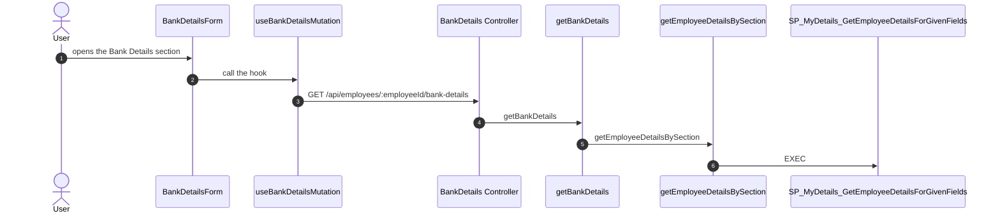

# Command: create-flows

## Context

This command is the **React + Node API** request-tracer. It is narrower than
`/document-feature` (which covers WebForms pages, DAL/BLL, and table ER
diagrams) and it does not touch the interactive My Details graph served at
`/flows` (`apps/backstage/features/flows/`, built by
`index-request-flow.ts` — that stays scoped to My Details only).

The HRMS Node API apps follow a fixed shape per feature
(`.cursor/rules/api-endpoint-conventions.mdc` in each `*.WebAPI.Node`
project):

```
Features/<Domain>/<Feature>/
  routes.js      # express.Router() — HTTP verb + path -> Controller handler
  Controller.js  # PascalCase handlers (req, res, next) — validation + response shaping
  Service.js     # camelCase business logic, no req/res
ORM/Data/<verbName>.js         # one data operation, imported via #orm/Data/<name>
ORM/Repositories/<Name>.js     # or a repository, imported via #orm/Repositories/<Name>
```

A request starts in a React component under
`d:\TDG HRMS\SourceCode\HRMS.Web\HRMS.Web\HRM\<App>_React\src\`, usually via a
hook or client re-exported from `@hrms/sdk` (checkout `D:/hrms-sdk`, same repo
id `hrms-sdk` used by `apps/backstage/features/flows/paths.ts`). It ends in a
named stored procedure or user-defined function in
`d:\TDG HRMS DB\HRMS-DATABASE\<Database>\{STOREPROCEDURE,Stored
Procedures,FUNCTIONS}\` that itself calls nothing further — the same leaf
condition `/explain-stored-procedure` uses.

Output home:

```
d:\hrms\apps\backstage\content\flows\<slug>.md
```

Served at `/docs/flows/<slug>`. Dropping the file is enough once the loader
exists (`lib/flow-docs.ts`, discovered the same way as
`lib/database-docs.ts` and `lib/guides.ts`).

## Task

Given a feature name (`$ARGUMENTS`, or the text after `/create-flows`), trace
every HTTP action that feature's UI makes, from the component through the
controller/service to the last stored procedure or function, and write one
Backstage page with a `sequenceDiagram` per action. Fill in any stored
procedure or function page that is missing or stale along the way by
following `/explain-stored-procedure` for that object.

If the name is empty, stop and ask for one.

## Steps

1. **Resolve the feature name.** Take it from the invocation argument
   (`$ARGUMENTS` if expanded, otherwise the remainder of the user message
   after `/create-flows`). If empty, stop and ask.

2. **Find the UI.** Search
   `d:\TDG HRMS\SourceCode\HRMS.Web\HRMS.Web\HRM\` for the `*_React` app (or
   other React app) whose component names or folder match the feature
   (case-insensitive, tolerate spacing/casing — "Bank Details" ↔
   `BankDetails`, `bankDetails`). For each component that starts a request on
   mount, submit, or user action, record:
   - the component file and line (`file:line`)
   - the `@hrms/sdk` hook/client it calls (e.g. `useBankDetailsMutation`), or
     a direct `fetch`/HTTP client call when the component does not go through
     the SDK
   If multiple components start requests for this feature (list view, detail
   view, bulk edit), include each as its own entry point.
   If the `hrms-sdk` checkout is not in the workspace, say so in the output
   and still record the component and the hook name from the import — do not
   invent what the hook does internally.

3. **Find the API.** Search `Features/<Domain>/<Feature>/` across every
   `*.WebAPI.Node` project (check `HRMS.CoreAPI/HRMS.Core.WebAPI.Node/Features/`
   first; it holds most employee-facing features). For each HTTP action
   relevant to this feature:
   - Read `routes.js` for the verb and path (e.g. `GET
     /api/employees/:employeeId/bank-details`), and the middleware chain
     (e.g. `requireEmployeeId`, `validateRequest`) when it rejects bad input
     before the handler runs.
   - Read `Controller.js` for the handler (`file:line`) — validation and
     response shaping only, per that project's rule.
   - Read `Service.js` for the business logic it delegates to (`file:line`).
   - Follow database calls into `ORM/Data/<name>.js` or
     `ORM/Repositories/<Name>.js` (imported via `#orm/Data/*` or
     `#orm/Repositories/*`) — that module is its own hop, and it is normally
     where `executeStoredProcedure` / a literal `EXEC` string lives, not
     inline in `Service.js`.
   If the feature has no controller/service in any `*.WebAPI.Node` project
   (pure WebForms postback), stop and tell the user to run
   `/document-feature` instead — this command only traces the React/Node
   path.

4. **Walk the database to the leaves.** From each `EXEC` / named
   user-defined function call found in step 3, resolve the script under
   `d:\TDG HRMS DB\HRMS-DATABASE\<Database>\` the same way
   `/explain-stored-procedure` does:
   - Procedures: `STOREPROCEDURE/` and `Stored Procedures/`
   - Functions: `FUNCTIONS/`
   - Skip SQL Server built-ins and `sys.*`. List `sp_executesql` and other
     dynamic SQL under **Known gaps** instead of guessing the target.
   Keep a visited set and repeat for every nested call until each branch
   ends at an object that calls nothing further — that object is the leaf
   for this request.
   If the same object name exists in more than one database, stop and ask
   which one, same as `/explain-stored-procedure`.

5. **Fill missing procedure pages.** For every procedure or function
   collected in step 4, check
   `apps/backstage/content/database/<database-slug>/<ObjectName>.md`
   (slug table is the same one `/explain-stored-procedure` uses). When that
   page is missing, or the SQL file is newer than the page's
   `last-analyzed`, run that command's steps for this object: it writes the
   page and every nested callee's page in one pass, so do not start it again
   for an object it already wrote in this run. Link every object in this
   feature's page to `/docs/database/<slug>/<ObjectName>`.

6. **Write the feature page** at
   `apps/backstage/content/flows/<slug>.md` (kebab-case the feature name).
   Before writing:
   - If the current file exists, read its `last-analyzed`. When that date is
     `YYYY-MM-DD` and is not today, copy the file to
     `content/flows/<slug>/<last-analyzed>.md` unless that archive already
     exists (leave existing archives immutable). A same-day rewrite
     overwrites the latest file only.
   - Set `last-analyzed` on the new latest page to today's date.

7. **Tell the user** the URL of the feature page, one HTTP action per
   `sequenceDiagram` written, the count of procedure/function pages written
   or left unchanged by step 5, and anything under Known gaps.

## Page template

Frontmatter is a closed block; the loader strips it.

````markdown
---
feature: Bank Details
confidence: <low|medium|high>
last-analyzed: <today's date, YYYY-MM-DD>
---

# Bank Details

## Overview

One short paragraph: what the user does on screen, and which component
starts each request traced below.

## Get bank details



One `sequenceDiagram` per HTTP action that reaches the database (a GET and a
PUT for the same screen are two diagrams). Participants, left to right, only
for hops that exist in source: `User` -> component -> SDK hook / HTTP client
-> controller -> service -> ORM data module -> first procedure -> nested
procedures/functions -> leaf. Every arrow must match a row in the steps
table below it — never invent a hop. Note text must not contain a colon
(mermaid treats the first `:` as the delimiter).

## Steps

| Step | What happens | File | Object |
|---|---|---|---|
| 1 | Screen opens the section | `HRMS.Web/HRMS.Web/HRM/MyDetails_React/src/components/sections/bankDetails/BankDetailsForm.tsx:12` | |
| 2 | Hook calls the API | `hrms-sdk/src/.../useBankDetailsMutation.ts:8` | |
| 3 | Route maps the request | `HRMS.CoreAPI/HRMS.Core.WebAPI.Node/Features/Employee/MyDetails/routes.js:469` | |
| 4 | Handler reads the employee id | `HRMS.CoreAPI/HRMS.Core.WebAPI.Node/Features/Employee/MyDetails/BankDetails/Controller.js:13` | |
| 5 | Service delegates to the ORM helper | `HRMS.CoreAPI/HRMS.Core.WebAPI.Node/Features/Employee/MyDetails/BankDetails/Service.js:12` | |
| 6 | ORM helper executes the procedure | `HRMS.CoreAPI/HRMS.Core.WebAPI.Node/ORM/Data/getEmployeeDetailsBySection.js:1` | [SP_MyDetails_GetEmployeeDetailsForGivenFields](/docs/database/hrms/SP_MyDetails_GetEmployeeDetailsForGivenFields) |

Repeat the Steps table + sequence diagram pair for each additional HTTP
action under its own `##` heading.

## Stored procedures and functions

| Object | Kind | Leaf | Page |
|---|---|---|---|
| `SP_MyDetails_GetEmployeeDetailsForGivenFields` | procedure | no | [SP_MyDetails_GetEmployeeDetailsForGivenFields](/docs/database/hrms/SP_MyDetails_GetEmployeeDetailsForGivenFields) |

One row per distinct object reached across every action on this page. "Leaf"
is `yes` when that object calls no further procedure or function.

## Known gaps

Dynamic SQL, an `hrms-sdk` checkout that was not in the workspace, ambiguous
component matches, or an object name that exists in more than one database.
Omit this section when there is none.

## Reference

### SourceCode

- Component, SDK, controller, service, and ORM files cited above.

### TDG HRMS DB

- Procedure and function scripts cited above.
````

Use standard mermaid fences. Cite every hop with a repo-relative `path:line`.
Do not invent components, routes, parameters, or callees that are not in the
source.

## Do not

- Do not commit. This only changes files in the `hrms` working tree.
- Do not regenerate `apps/backstage/content/flows/flow-graph.json` or the
  `/flows` graph screen — that pipeline stays scoped to My Details.
- Do not duplicate a procedure/function page's own analysis here; link to it
  instead of re-describing its body.
