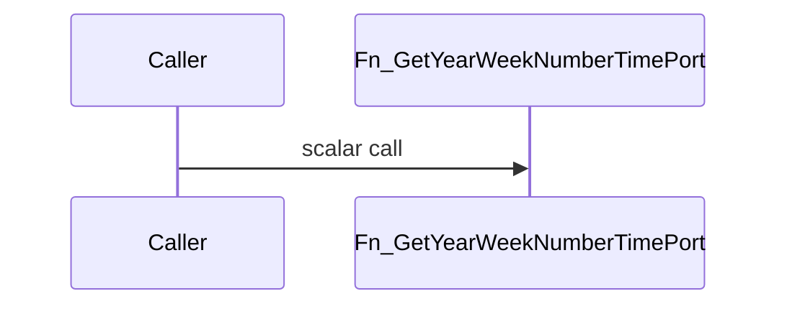
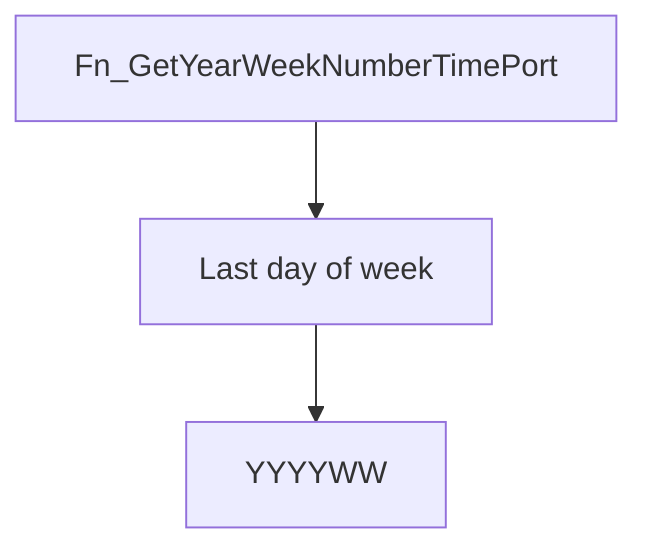

# Fn_GetYearWeekNumberTimePort

## What it does

Scalar helper that returns `YYYYWW` (year concatenated with week number of the week’s last day) for a given date, used by the Sync Approval job SP.

## Parameters

| Name | Direction | What it is for |
|---|---|---|
| `@Date` | in | Input date |

## Call sequence

## Callers

| Object | Kind | Page |
|---|---|---|
| `SP_TS_JOB_SentForApprovalByReviewFrequencyApprover` | procedure | [SP_TS_JOB_SentForApprovalByReviewFrequencyApprover](/docs/database/hrm-timeport/SP_TS_JOB_SentForApprovalByReviewFrequencyApprover) |

## Nested

Calls no other procedures or functions.

## Steps

In `HRMS-DATABASE/HRM-TIMEPORT/FUNCTIONS/Fn_GetYearWeekNumberTimePort.sql`:

1. Normalize day-of-week (Sunday → 7).
2. Find last day of that week.
3. Return CONCAT(year, zero-padded week number).

## Tables

| Table | Read or write |
|---|---|
| none | — |

## Flow

