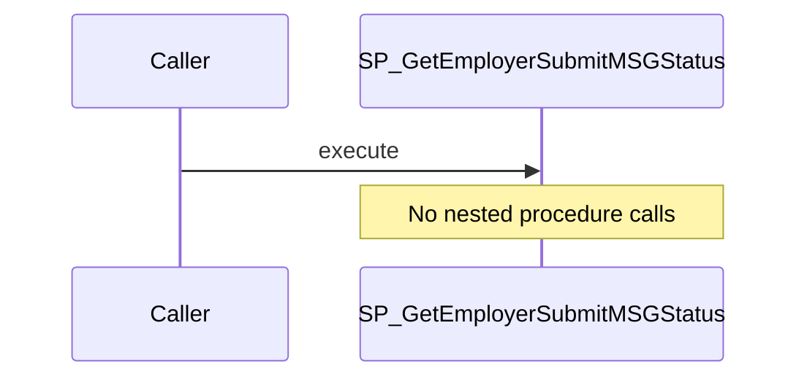
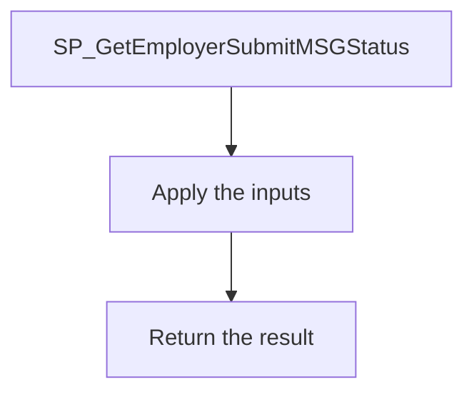

# SP_GetEmployerSubmitMSGStatus

## What it does

Returns whether the employer should show the allocated-hours message on timesheet submit (`AllocatedHoursMSGFlag`, default 1 when null).

## Parameters

| Name | Direction | What it is for |
|---|---|---|
| `@EmployerId` | in | Employer id |

## Call sequence

## Callers

Application caller: TimePort API `GetEmployerSubmitMSGStatus` for TimePort → TimeSheet submit UX.

## Nested

| Object | Kind | When | Page |
|---|---|---|---|
| _(none)_ | — | — | — |

## Steps

In `HRMS-DATABASE/HRM-TIMEPORT/STOREPROCEDURE/SP_GetEmployerSubmitMSGStatus.sql`:

1. Select EmployerID and ISNULL(AllocatedHoursMSGFlag, 1) from `TTSSubmitMSGConfigStatus`.

## Tables

| Table | Read or write |
|---|---|
| `TTSSubmitMSGConfigStatus` | read |

## Unresolved calls

None identified beyond the nested objects listed above.

## Flow

