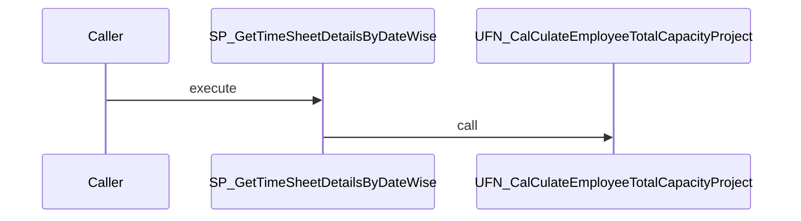
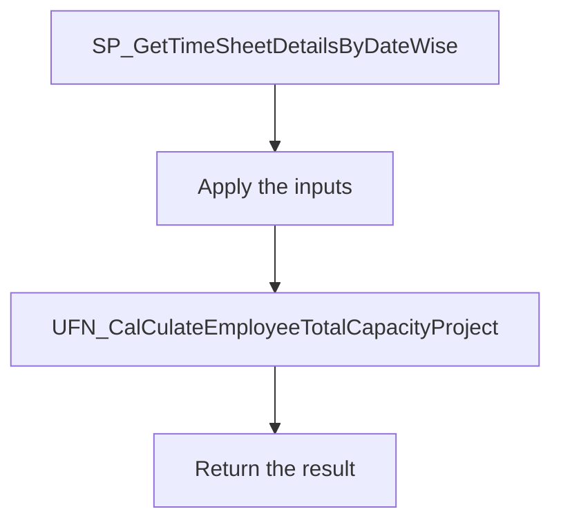

# SP_GetTimeSheetDetailsByDateWise

## What it does

Returns the employee's allocated-versus-logged hours by project for one month. The Home card calls this through the Timeport API.

## Parameters

| Name | Direction | What it is for |
|---|---|---|
| `@Employeeid` | in | Employee the Home screen is loading or acting for (`INT`) |
| `@month` | in | Month number for the attendance or timesheet card (`INT`) |
| `@year` | in | Year for the attendance or timesheet card (`INT`) |

## Call sequence

## Callers

No other procedure or function under STOREPROCEDURE or FUNCTIONS executes this object.

## Nested

| Object | Kind | When | Page |
|---|---|---|---|
| `UFN_CalCulateEmployeeTotalCapacityProject` | function | Called while this object runs | [UFN_CalCulateEmployeeTotalCapacityProject](/docs/database/hrm-timeport/UFN_CalCulateEmployeeTotalCapacityProject) |

## Steps

In `HRMS-DATABASE/HRM-TIMEPORT/STOREPROCEDURE/SP_GetTimeSheetDetailsByDateWise.sql`:

1. Returns the employee's allocated-versus-logged hours by project for one month.
2. The Home card calls this through the Timeport API.

## Tables

| Table | Read or write |
|---|---|
| `TEmployeeInfo` | read |
| `TProject` | read |
| `ttsemptimesheet` | read |
| `ttsprojectconfiguration` | read |
| `TSHIFTMASTER` | read |

## Flow

