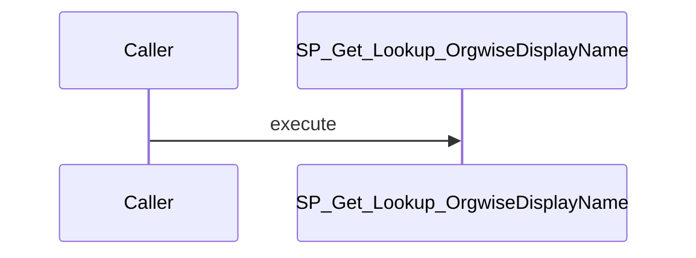
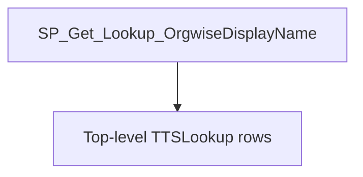

# SP_Get_Lookup_OrgwiseDisplayName

## What it does

Returns top-level (parent) `TTSLookup` display names for an employer used as org-specific labels (SDLC / work item / artifact / location headings) in the approval detail UI.

## Parameters

| Name | Direction | What it is for |
|---|---|---|
| `@employerid` | in | Employer |

## Call sequence

## Callers

No other procedure or function under STOREPROCEDURE or FUNCTIONS executes this object. Application caller: TimePort DAL `LookupOrgwiseDisplayName`.

## Nested

Calls no other procedures or functions.

## Steps

In `HRMS-DATABASE/HRM-TIMEPORT/STOREPROCEDURE/SP_Get_Lookup_OrgwiseDisplayName.sql`:

1. Select Lookup_ID / Name / Description from `TTSLookup` where parent id is 0, not deleted, for the employer.

## Tables

| Table | Read or write |
|---|---|
| `TTSLookup` | read |

## Flow

