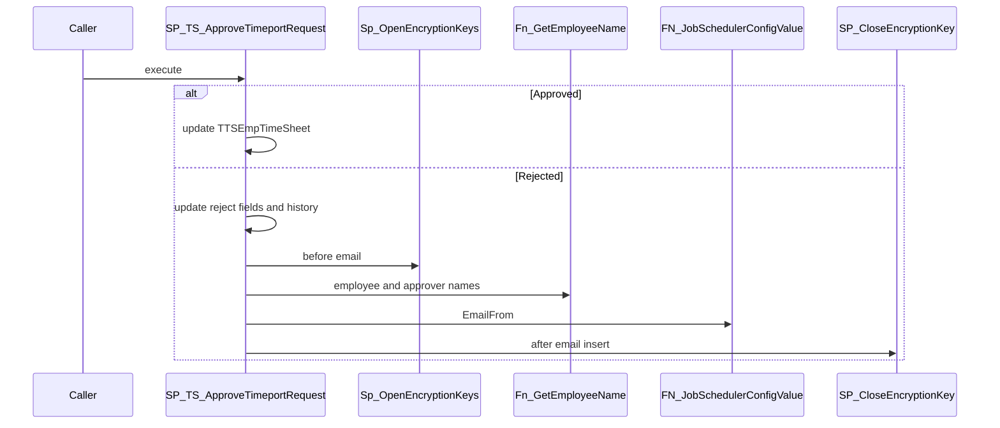
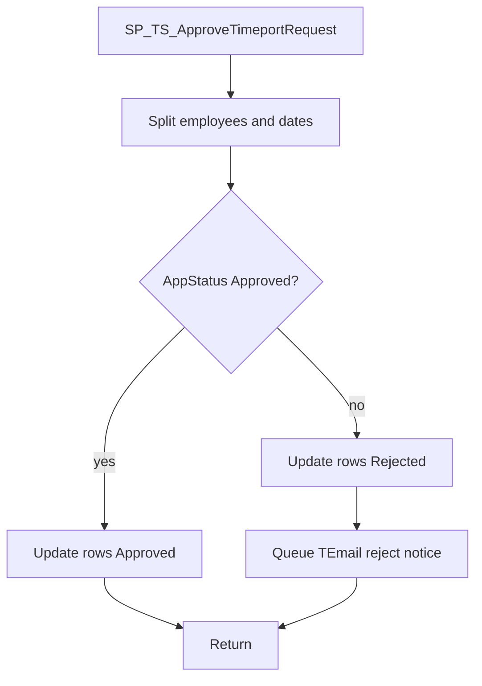

# SP_TS_ApproveTimeportRequest

## What it does

Applies approve or reject to `TTSEmpTimeSheet` rows for one project and a set of employee/date pairs. On Approved it sets status, approver, comments, and approvedDate. On Rejected it sets reject fields, deactivates matching submitted-history rows, and queues a reject email in `TEmail`.

## Parameters

| Name | Direction | What it is for |
|---|---|---|
| `@pEmployerId` | in | Employer of the timesheet rows |
| `@FromDate` / `@ToDate` | in | Comma-aligned date lists per employee |
| `@Employeeid` | in | Comma-separated employee ids |
| `@ApprovedBy` | in | Approver employee id |
| `@AppStatus` | in | Target status id (Approved vs other → Rejected path) |
| `@comments` | in | Approver / reject comments |
| `@ProjectID` | in | Project filter |
| `@oldTsStatus` | in | Optional prior status guard |

## Call sequence

## Callers

No other procedure or function under STOREPROCEDURE or FUNCTIONS executes this object. Application caller: TimePort DAL `ApproveTimeportRequest`.

## Nested

| Object | Kind | When | Page |
|---|---|---|---|
| `Sp_OpenEncryptionKeys` | procedure | reject email path | [Sp_OpenEncryptionKeys](/docs/database/hrms/Sp_OpenEncryptionKeys) |
| `Fn_GetEmployeeName` | function | reject subject text | [Fn_GetEmployeeName](/docs/database/hrms/Fn_GetEmployeeName) |
| `FN_JobSchedulerConfigValue` | function | EmailFrom | No page yet (TimePort synonym to HRMS) |
| `SP_CloseEncryptionKey` | procedure | after reject email | [SP_CloseEncryptionKey](/docs/database/hrms/SP_CloseEncryptionKey) |
| `Split` | function | parse comma lists | [Split](/docs/database/hrms/Split) |

## Steps

In `HRMS-DATABASE/HRM-TIMEPORT/STOREPROCEDURE/SP_TS_ApproveTimeportRequest.sql`:

1. Split employee/date lists into `#EmployeeResults`.
2. Compute week/frequency counts from `TTSEmpTimeSheet`.
3. If `@AppStatus` is Approved status id: update matching rows with status, approver, comments, approvedDate (optional `@oldTsStatus` guard).
4. Else treat as reject: update reject fields/status, deactivate `TSEmpTimesheetSubmitted_History`, build HTML email, insert `TEmail`, open/close encryption around name/email reads.

## Tables

| Table | Read or write |
|---|---|
| `TTSEmpTimeSheet` | read/write |
| `TSEmpTimesheetStatus` | read |
| `TSEmpTimesheetSubmitted_History` | write |
| `TEmployee` | read |
| `TProject` | read |
| `TEmail` | write |

## Flow

