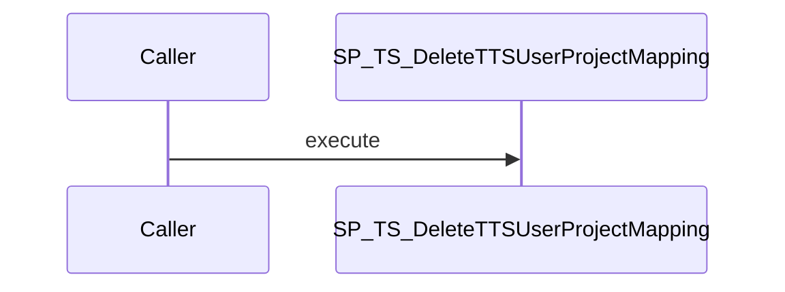
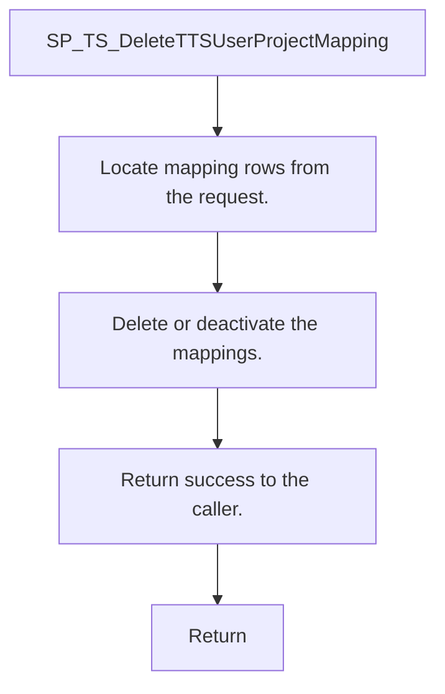

# SP_TS_DeleteTTSUserProjectMapping

## What it does

Deletes or remaps TimePort user-project mapping rows from the Resource Mapping tab.

## Parameters

| Name | Direction | What it is for |
|---|---|---|
| `@MappingId` | in | Mapping id(s) from request body |
| `@LoginUserID` | in | Acting employee id |

## Call sequence

## Callers

Application only. timeportDAL.DeleteTTSUserProjectMapping.

## Nested

This object does not execute another procedure or user-defined function.

## Steps

In `HRMS-DATABASE/HRM-TIMEPORT/STOREPROCEDURE/SP_TS_DeleteTTSUserProjectMapping.sql`:

1. Locate mapping rows from the request.
2. Delete or deactivate the mappings.
3. Return success to the caller.

## Tables

| Table | Read or write |
|---|---|
| `TTSUserProjectMapping` | write |

## Unresolved calls

None recorded for this page.

## Flow

