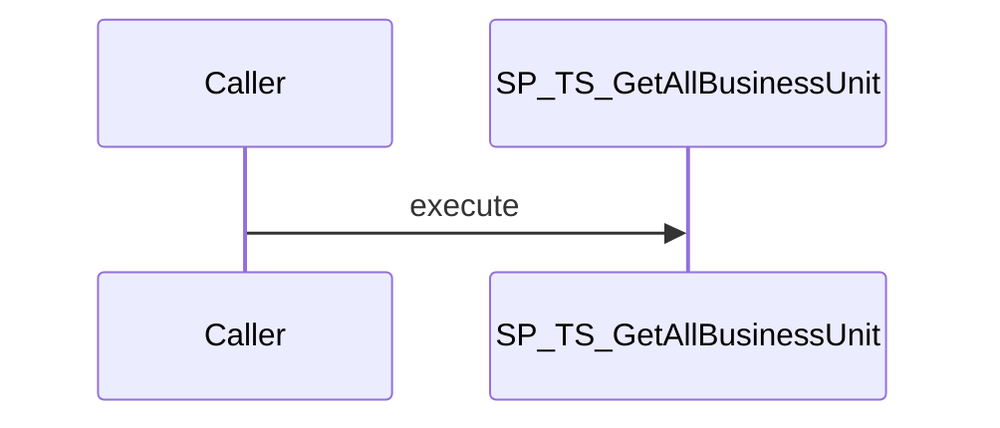
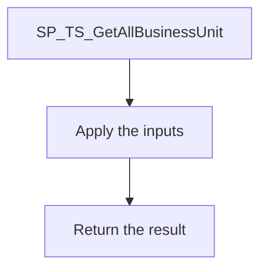

# SP_TS_GetAllBusinessUnit

## What it does

Called from the Home dashboard path. It reads torghierarchydetails and returns the result to its caller.

## Parameters

| Name | Direction | What it is for |
|---|---|---|
| `@EmployerId` | in | Employer that owns the data (`Int`) |

## Call sequence

## Callers

| Object | Kind | Page |
|---|---|---|
| `SP_EmployeeInformation_AgeRangeofEmployees_GlobalFilter` | procedure | No page yet |
| `SP_EmployeeInformation_Designation_GlobalFilter` | procedure | No page yet |
| `SP_EmployeeInformation_Domain_GlobalFilter` | procedure | No page yet |
| `SP_EmployeeInformation_EmploymentType_GlobalFilter` | procedure | No page yet |
| `SP_EmployeeInformation_ExperienceInCurrentOrganization_GlobalFilter` | procedure | No page yet |
| `SP_EmployeeInformation_GenderRatio_GlobalFilter` | procedure | No page yet |
| `SP_EmployeeInformation_Grade_GlobalFilter` | procedure | No page yet |
| `SP_EmployeeInformation_HighestEducation_GlobalFilter` | procedure | No page yet |
| `SP_EmployeeInformation_Passport_GlobalFilter` | procedure | No page yet |
| `SP_EmployeeInformation_PreviousWorkExperience_GlobalFilter` | procedure | No page yet |
| `SP_EmployeeInformation_Shift_GlobalFilter` | procedure | No page yet |
| `SP_EmployeeInformation_SkillDistribution_GlobalFilter` | procedure | No page yet |
| `SP_EmployeeManagement_StatusOfBackgroundVerification_GlobalFilter` | procedure | No page yet |
| `SP_EmployeeManagement_StatusofCandidatesPreOnboarding` | procedure | No page yet |
| `SP_EmployeeSelfService_VoucherRequestStatus_GlobalFilter` | procedure | No page yet |
| `SP_Expense_ExpensePattern_GlobalFilter` | procedure | No page yet |
| `SP_ManagementDashboard_ResignationPullback_GlobalFilter` | procedure | No page yet |
| `SP_ManagementDashboard_TotalExperience_GlobalFilter` | procedure | No page yet |
| `SP_Other_EmployeeOnLeaves_GlobalFilter` | procedure | No page yet |
| `SP_Others_VacancyByLocation` | procedure | [SP_Others_VacancyByLocation](/docs/database/hrms/SP_Others_VacancyByLocation) |
| `SP_PMS_AssessmentTenure_Cycle_GlobalFilter` | procedure | No page yet |
| `SP_PMS_ConfirmationStatus_GlobalFilter` | procedure | No page yet |
| `SP_Recruitment_TATSuccessRate` | procedure | No page yet |
| `SP_Separation_ExitReason_GlobalFilter` | procedure | No page yet |
| `SP_Surveys_SurveyStatus_GlobalFilter` | procedure | No page yet |
| `USP_AppraisalCycles_By_EmployerandBU_GlobalFilter` | procedure | No page yet |
| `USP_Business_Unit_Average_Tenure_GlobalFilter` | procedure | No page yet |
| `USP_Employee_Management_RecruitmentPreOnboarding` | procedure | No page yet |
| `USP_Employee_Management_RecruitmentPreOnboarding_GlobalFilter` | procedure | No page yet |
| `USP_HRMS_HeadCount_By_Function_GlobalFilter` | procedure | No page yet |
| `USP_LA_EmployeeAttendanceModeOverview_GlobalFilter` | procedure | No page yet |
| `USP_LA_EmployeeAttendanceOverview_GlobalFilter` | procedure | No page yet |
| `USP_Productivity_Utilization_Chart_GlobalFilter` | procedure | No page yet |
| `usp_RRSStatusDistribution_Count` | procedure | No page yet |
| `USP_TS_GetTimeSheetStatusCountReport_GlobalFilter` | procedure | No page yet |

## Nested

This object does not execute another procedure or user-defined function.

## Steps

In `HRMS-DATABASE/HRM-TIMEPORT/STOREPROCEDURE/SP_TS_GetAllBusinessUnit.sql`:

1. Read `torghierarchydetails`.
2. Return the result set to the caller.

## Tables

| Table | Read or write |
|---|---|
| `torghierarchydetails` | read |

## Flow

