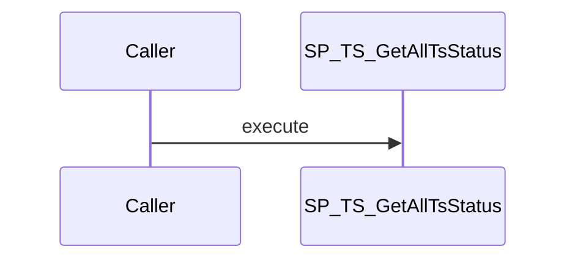
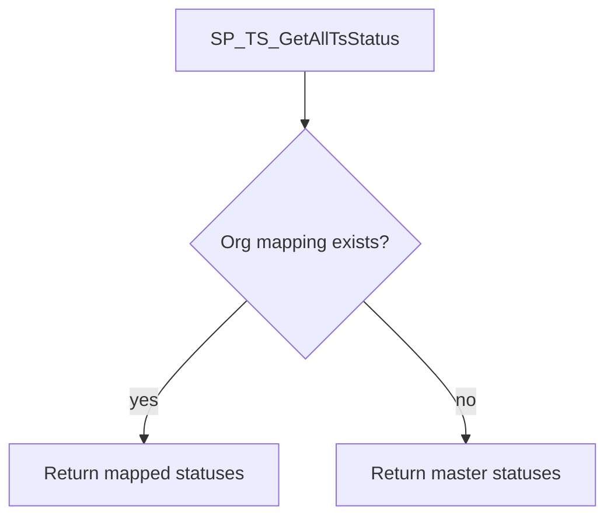

# SP_TS_GetAllTsStatus

## What it does

Returns timesheet status ids/descriptions for an employer. If org-specific rows exist in `TSEmpTimesheetStatusMapWithOrg`, those are returned (joined to the master); otherwise the global `TSEmpTimesheetStatus` list is returned.

## Parameters

| Name | Direction | What it is for |
|---|---|---|
| `@Employerid` | in | Employer whose status mapping is preferred |

## Call sequence

## Callers

No other procedure or function under STOREPROCEDURE or FUNCTIONS executes this object. Application caller: TimePort DAL `GetAllTsStatus`.

## Nested

Calls no other procedures or functions.

## Steps

In `HRMS-DATABASE/HRM-TIMEPORT/STOREPROCEDURE/SP_TS_GetAllTsStatus.sql`:

1. If org mapping rows exist for `@EmployerId`, select mapped statuses joined to master.
2. Else select all rows from `TSEmpTimesheetStatus`.

## Tables

| Table | Read or write |
|---|---|
| `TSEmpTimesheetStatusMapWithOrg` | read |
| `TSEmpTimesheetStatus` | read |

## Flow

