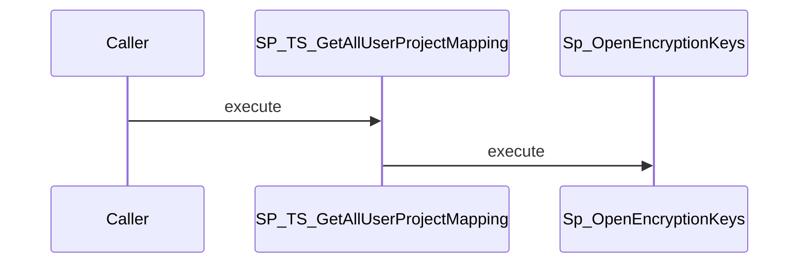
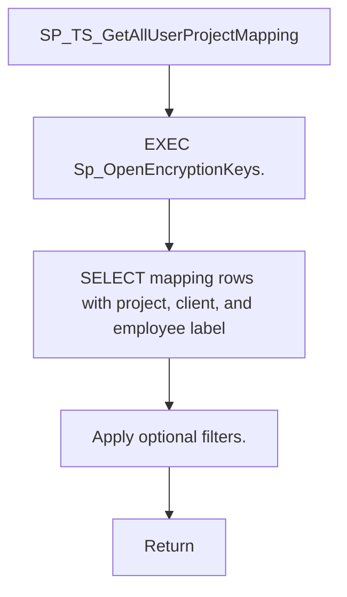

# SP_TS_GetAllUserProjectMapping

## What it does

Returns resource-mapping rows for an employer with optional filters on clients, employees, project configs, allocation dates, and timesheet approvers. Opens encryption keys for name fields.

## Parameters

| Name | Direction | What it is for |
|---|---|---|
| `@EmployerID` | in | Employer id |
| `@EmployeeID` | in | Login employee id |
| `@ClientIds` | in | Optional client ids |
| `@Employees` | in | Optional employee ids |
| `@ProjectConfigIds` | in | Optional project config ids |
| `@AllocationStartDate` | in | Optional start filter |
| `@AllocationEndDate` | in | Optional end filter |
| `@TimesheetApprovers` | in | Optional approver ids |

## Call sequence

## Callers

Application only. timeportDAL.GetAllUserProjectMapping.

## Nested

| Object | Kind | Page |
|---|---|---|
| `Sp_OpenEncryptionKeys` | procedure | [Sp_OpenEncryptionKeys](/docs/database/hrms/Sp_OpenEncryptionKeys) |

## Steps

In `HRMS-DATABASE/HRM-TIMEPORT/STOREPROCEDURE/SP_TS_GetAllUserProjectMapping.sql`:

1. EXEC Sp_OpenEncryptionKeys.
2. SELECT mapping rows with project, client, and employee labels.
3. Apply optional filters.

## Tables

| Table | Read or write |
|---|---|
| `TTSUserProjectMapping` | read |
| `TTSProjectConfiguration` | read |
| `TEmployee` | read |

## Unresolved calls

None recorded for this page.

## Flow

