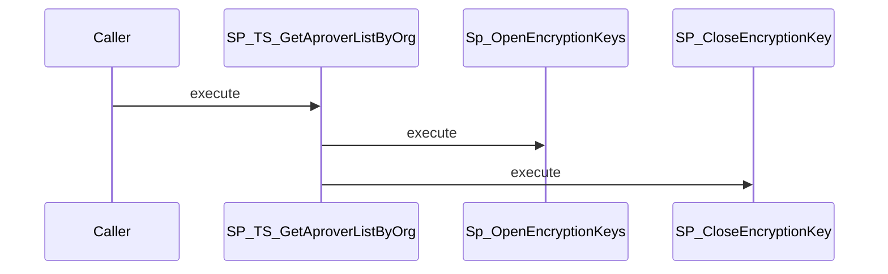
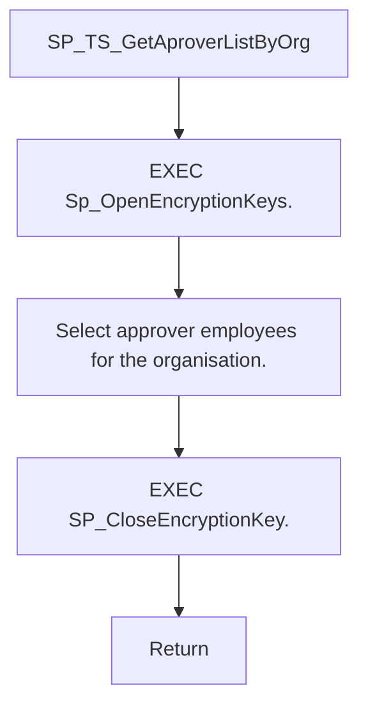

# SP_TS_GetAproverListByOrg

## What it does

Returns the organisation approver list for TimePort project configuration and mapping screens. Opens and closes encryption keys around encrypted name fields.

## Parameters

| Name | Direction | What it is for |
|---|---|---|
| `@employerId` | in | Employer id |

## Call sequence

## Callers

Application only. timeportDAL.GetAproverListByOrg.

## Nested

| Object | Kind | Page |
|---|---|---|
| `Sp_OpenEncryptionKeys` | procedure | [Sp_OpenEncryptionKeys](/docs/database/hrms/Sp_OpenEncryptionKeys) |
| `SP_CloseEncryptionKey` | procedure | [SP_CloseEncryptionKey](/docs/database/hrms/SP_CloseEncryptionKey) |

## Steps

In `HRMS-DATABASE/HRM-TIMEPORT/STOREPROCEDURE/SP_TS_GetAproverListByOrg.sql`:

1. EXEC Sp_OpenEncryptionKeys.
2. Select approver employees for the organisation.
3. EXEC SP_CloseEncryptionKey.

## Tables

| Table | Read or write |
|---|---|
| `TEmployee` | read |
| `TEmployeeInfo` | read |

## Unresolved calls

None recorded for this page.

## Flow

