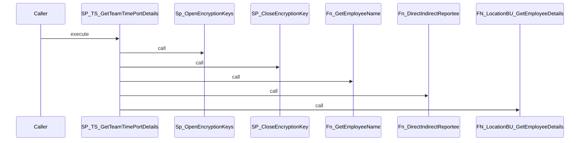
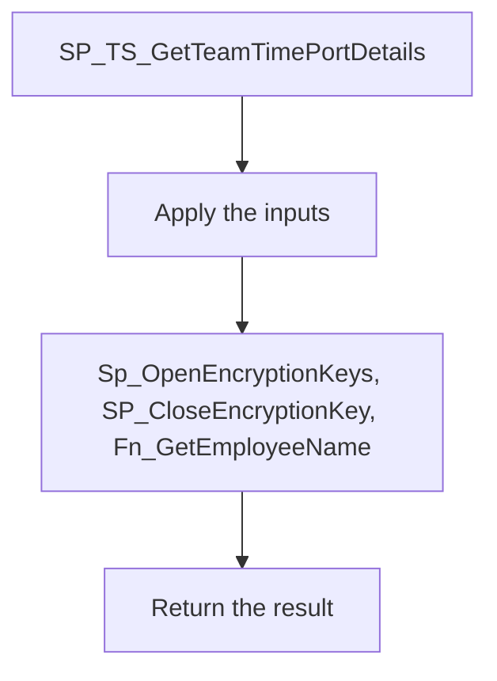

# SP_TS_GetTeamTimePortDetails

## What it does

Returns the team's allocated-versus-logged hours by project for one month. The Home card calls this when the viewer is looking at the team timesheet.

## Parameters

| Name | Direction | What it is for |
|---|---|---|
| `@Employeeid` | in | Employee the Home screen is loading or acting for (`INT`) |
| `@month` | in | Month number for the attendance or timesheet card (`INT`) |
| `@year` | in | Year for the attendance or timesheet card (`INT`) |

## Call sequence

## Callers

No other procedure or function under STOREPROCEDURE or FUNCTIONS executes this object.

## Nested

| Object | Kind | When | Page |
|---|---|---|---|
| `Sp_OpenEncryptionKeys` | procedure | Called while this object runs | [Sp_OpenEncryptionKeys](/docs/database/hrms/Sp_OpenEncryptionKeys) |
| `SP_CloseEncryptionKey` | procedure | Called while this object runs | [SP_CloseEncryptionKey](/docs/database/hrms/SP_CloseEncryptionKey) |
| `Fn_GetEmployeeName` | function | Called while this object runs | [Fn_GetEmployeeName](/docs/database/hrms/Fn_GetEmployeeName) |
| `Fn_DirectIndirectReportee` | function | Called while this object runs | [Fn_DirectIndirectReportee](/docs/database/hrms/Fn_DirectIndirectReportee) |
| `FN_LocationBU_GetEmployeeDetails` | function | Called while this object runs | [FN_LocationBU_GetEmployeeDetails](/docs/database/hrms/FN_LocationBU_GetEmployeeDetails) |

## Steps

In `HRMS-DATABASE/HRM-TIMEPORT/STOREPROCEDURE/SP_TS_GetTeamTimePortDetails.sql`:

1. Returns the team's allocated-versus-logged hours by project for one month.
2. The Home card calls this when the viewer is looking at the team timesheet.

## Tables

| Table | Read or write |
|---|---|
| `temployeeinfo` | read |
| `temployee` | read |
| `ttsemptimesheet` | read |

## Flow

