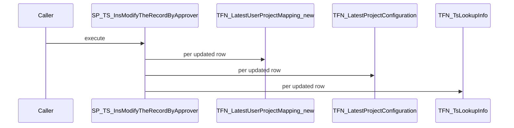
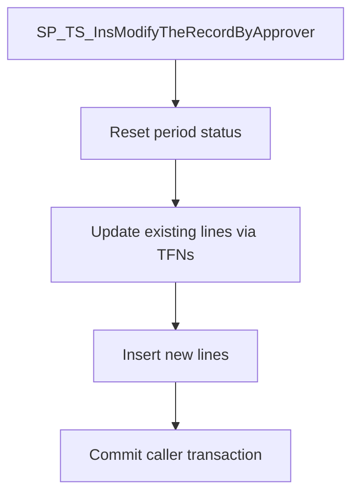

# SP_TS_InsModifyTheRecordByApprover

## What it does

Applies approver edits from TVP `Approver_EmpTimesheet`: resets status/comments on the period, updates existing `TTSEmpTimeSheet` rows (enriching billable/time-off/client fields via TFNs), and inserts new lines when needed, including admin freeze/status/comment fields.

## Parameters

| Name | Direction | What it is for |
|---|---|---|
| `@AdminComments` | in | Admin comments |
| `@AdminTSStatus` | in | Admin status |
| `@TSFrzee` | in | Freeze flag |
| `@startDate` / `@endDate` | in | Period for status reset |
| `@TimesheetDetails` | in | `Approver_EmpTimesheet` TVP of line edits |

## Call sequence

## Callers

No other procedure or function under STOREPROCEDURE or FUNCTIONS executes this object. Application caller: TimePort DAL `InsModifyTheRecordByApprover`.

## Nested

| Object | Kind | When | Page |
|---|---|---|---|
| `TFN_LatestUserProjectMapping_new` | function | OUTER APPLY on update | [TFN_LatestUserProjectMapping_new](/docs/database/hrm-timeport/TFN_LatestUserProjectMapping_new) |
| `TFN_LatestProjectConfiguration` | function | OUTER APPLY on update | [TFN_LatestProjectConfiguration](/docs/database/hrm-timeport/TFN_LatestProjectConfiguration) |
| `TFN_TsLookupInfo` | function | OUTER APPLY on update | [TFN_TsLookupInfo](/docs/database/hrm-timeport/TFN_TsLookupInfo) |

## Steps

In `HRMS-DATABASE/HRM-TIMEPORT/STOREPROCEDURE/SP_TS_InsModifyTheRecordByApprover.sql`:

1. Reset `TSStatus` / approver comments / approvedDate for matching period rows from the TVP.
2. Update existing `TTSEmpTimeSheet` rows by TimesheetId, applying TFN-derived IsTimeOff/IsHoliday/IsBillable/client/config fields.
3. Insert new TVP rows that do not already exist.
4. Apply admin freeze/status/comment updates as scripted.

## Tables

| Table | Read or write |
|---|---|
| `TTSEmpTimeSheet` | read/write |

## Flow

