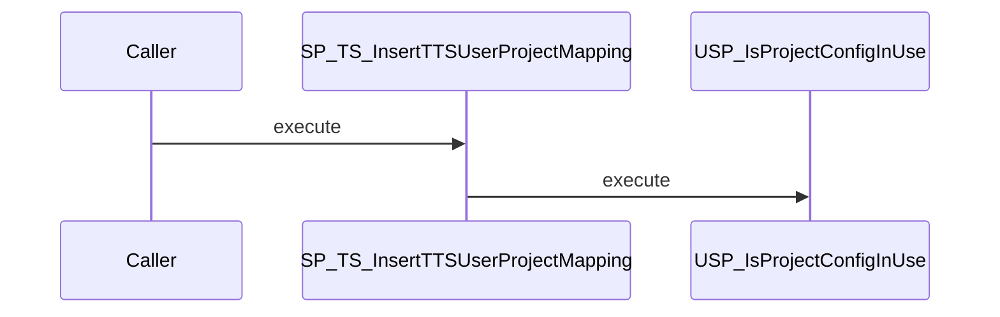
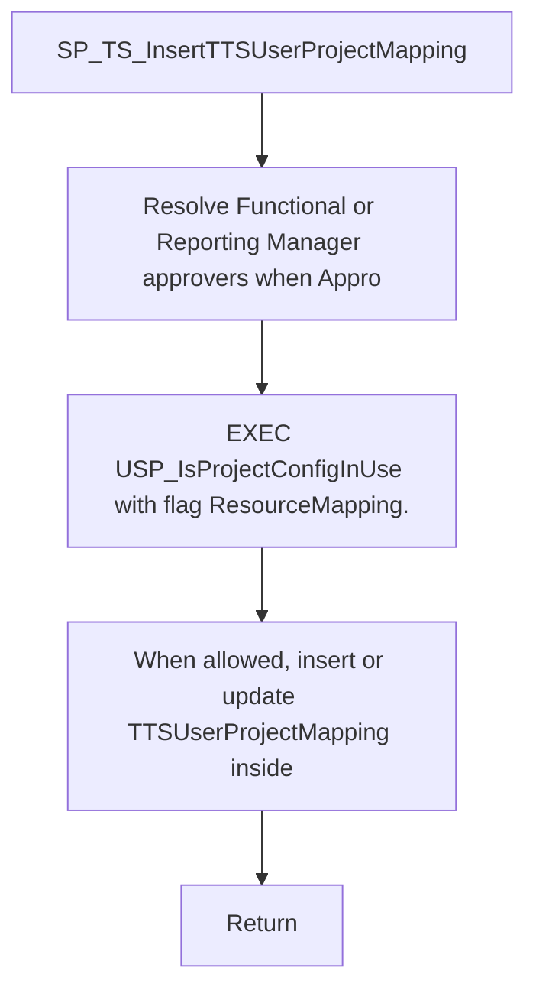

# SP_TS_InsertTTSUserProjectMapping

## What it does

Inserts or updates employee-to-project-configuration allocation rows from UDT_TTSUserProjectMapping, after USP_IsProjectConfigInUse ResourceMapping checks.

## Parameters

| Name | Direction | What it is for |
|---|---|---|
| `@TTSUserProjectMapping` | in | UDT_TTSUserProjectMapping table of mapping rows |

## Call sequence

## Callers

Application only. timeportDAL.InsertTTSUserProjectMapping.

## Nested

| Object | Kind | Page |
|---|---|---|
| `USP_IsProjectConfigInUse` | procedure | [USP_IsProjectConfigInUse](/docs/database/hrm-timeport/USP_IsProjectConfigInUse) |

## Steps

In `HRMS-DATABASE/HRM-TIMEPORT/STOREPROCEDURE/SP_TS_InsertTTSUserProjectMapping.sql`:

1. Resolve Functional or Reporting Manager approvers when ApproverType requires it.
2. EXEC USP_IsProjectConfigInUse with flag ResourceMapping.
3. When allowed, insert or update TTSUserProjectMapping inside a transaction.

## Tables

| Table | Read or write |
|---|---|
| `TTSUserProjectMapping` | write |
| `TEmployerDetails` | read |
| `TEmployeeInfo` | read |
| `TORGChart` | read |

## Unresolved calls

None recorded for this page.

## Flow

