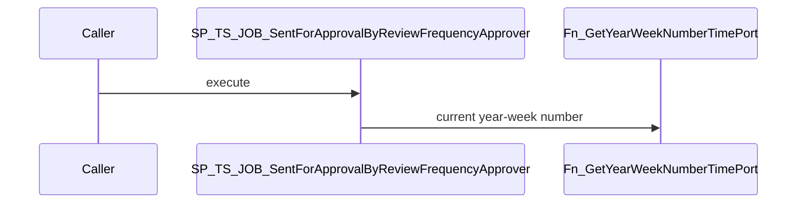
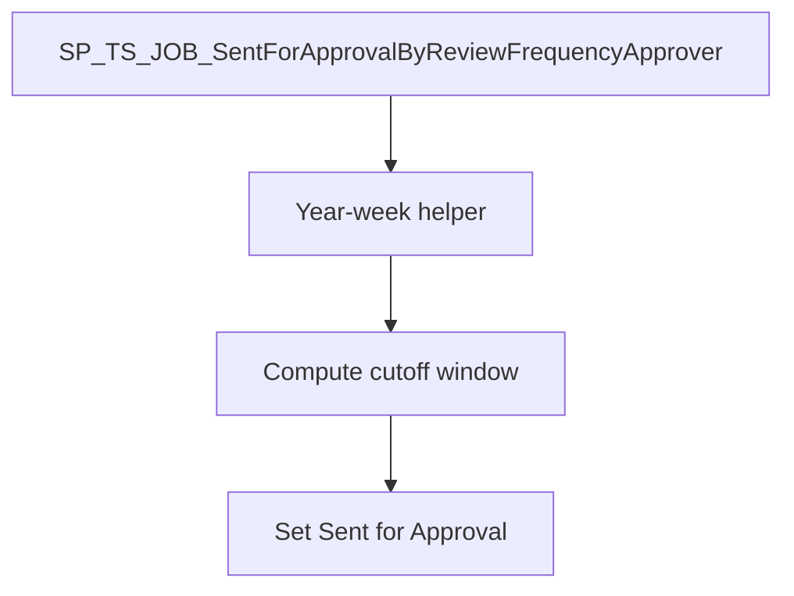

# SP_TS_JOB_SentForApprovalByReviewFrequencyApprover

## What it does

Sync Approval helper: for one timesheet approver, computes the current review-frequency cutoff window and updates eligible employee timesheet rows to Sent for Approval.

## Parameters

| Name | Direction | What it is for |
|---|---|---|
| `@TimesheetApprover` | in | Approver employee id |

## Call sequence

## Callers

No other procedure or function under STOREPROCEDURE or FUNCTIONS executes this object. Application caller: TimePort DAL `SentForApprovalByReviewFrequencyApprover`.

## Nested

| Object | Kind | When | Page |
|---|---|---|---|
| `Fn_GetYearWeekNumberTimePort` | function | start of job window calc | [Fn_GetYearWeekNumberTimePort](/docs/database/hrm-timeport/Fn_GetYearWeekNumberTimePort) |

## Steps

In `HRMS-DATABASE/HRM-TIMEPORT/STOREPROCEDURE/SP_TS_JOB_SentForApprovalByReviewFrequencyApprover.sql`:

1. Compute week number via `Fn_GetYearWeekNumberTimePort`.
2. Derive start/cutoff dates from month half (day > 15 vs earlier).
3. Update matching `TTSEmpTimeSheet` rows for the approver’s employees to Sent for Approval within that window.

## Tables

| Table | Read or write |
|---|---|
| `TTSEmpTimeSheet` | read/write |
| Related mapping/config tables used in filters | read |

## Flow

