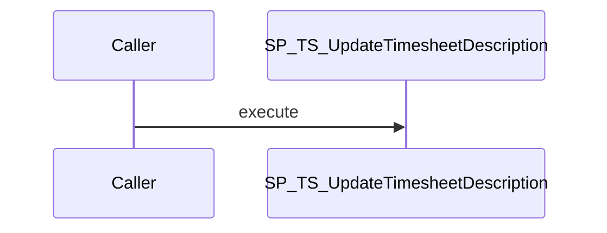
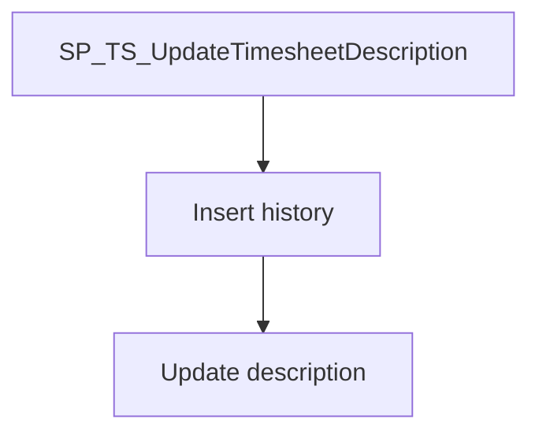

# SP_TS_UpdateTimesheetDescription

## What it does

Archives the current description of one timesheet line into `TTSEmpTimeSheetHistory`, then updates `TTSEmpTimeSheet.Description` and modification audit fields.

## Parameters

| Name | Direction | What it is for |
|---|---|---|
| `@TimeSheetId` | in | Line to update |
| `@Decription` | in | New description text |
| `@modifiedBy` | in | Actor employee id |

## Call sequence

## Callers

No other procedure or function under STOREPROCEDURE or FUNCTIONS executes this object. Application caller: TimePort DAL `UpdateTimesheetDescription`.

## Nested

Calls no other procedures or functions.

## Steps

In `HRMS-DATABASE/HRM-TIMEPORT/STOREPROCEDURE/SP_TS_UpdateTimesheetDescription.sql`:

1. INSERT prior description into `TTSEmpTimeSheetHistory`.
2. UPDATE `TTSEmpTimeSheet` description / ModifiedBy / ModifiedDate.
3. On error, return ERROR_* columns.

## Tables

| Table | Read or write |
|---|---|
| `TTSEmpTimeSheet` | read/write |
| `TTSEmpTimeSheetHistory` | write |

## Flow

