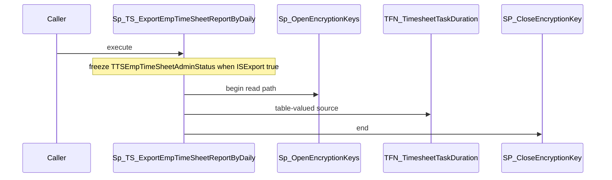
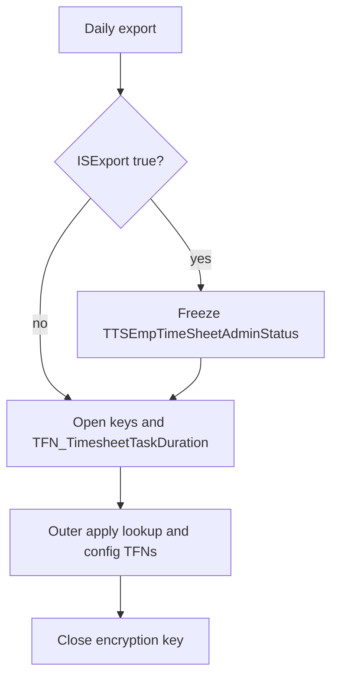

# Sp_TS_ExportEmpTimeSheetReportByDaily

## What it does

Returns day-level timesheet export lines for an employer/employee/project/date window. When `@ISExport = true`, freezes matching submitted/approved rows in `TTSEmpTimeSheetAdminStatus` before reading. The read path uses `TFN_TimesheetTaskDuration` plus lookup/config helpers, zeroing durations when holiday/leave export flags exclude them.

## Parameters

| Name | Direction | What it is for |
|---|---|---|
| `@EmployerId` | in | Employer filter |
| `@PFromDate` / `@PTodate` | in | Date window (varchar) |
| `@BusinessUnit` | in | Unused |
| `@ProjectId` | in | Comma-separated project ids |
| `@EmpId` | in | Employee whose timesheets are exported |
| `@ClientId` | in | Optional client filter into TFN |
| `@ReportType` | in | Frequency char (`D` default) |
| `@TsStatus` | in | Optional status filter |
| `@ISExport` | in | When true, freeze admin status then return rows |

## Call sequence

## Callers

Application: TimePort `ExportEmpTimeSheetReportByDaily` from TimeSheet Export PDF/Excel and detail paths. No other procedure or function calls this object.

## Nested

| Object | Kind | When | Page |
|---|---|---|---|
| `Sp_OpenEncryptionKeys` | procedure | read path | [Sp_OpenEncryptionKeys](/docs/database/hrms/Sp_OpenEncryptionKeys) |
| `TFN_TimesheetTaskDuration` | function | main FROM | [TFN_TimesheetTaskDuration](/docs/database/hrm-timeport/TFN_TimesheetTaskDuration) |
| `TFN_LookupInfo` | function | project name | [TFN_LookupInfo](/docs/database/hrm-timeport/TFN_LookupInfo) |
| `TFN_TsLookupInfo` | function | SDLC / work item / work product | [TFN_TsLookupInfo](/docs/database/hrm-timeport/TFN_TsLookupInfo) |
| `TFN_TsLookupInfoPlain` | function | location | [TFN_TsLookupInfoPlain](/docs/database/hrm-timeport/TFN_TsLookupInfoPlain) |
| `TFN_LatestProjectConfiguration` | function | review frequency | [TFN_LatestProjectConfiguration](/docs/database/hrm-timeport/TFN_LatestProjectConfiguration) |
| `TFN_DateRangeByReportType` | function | RF start/end | [TFN_DateRangeByReportType](/docs/database/hrm-timeport/TFN_DateRangeByReportType) |
| `Fn_GetEmployeeName` | function | employee/approver names | [Fn_GetEmployeeName](/docs/database/hrms/Fn_GetEmployeeName) |
| `UFN_CalCulateEmployeeTotalCapacityProject` | function | capacity columns | [UFN_CalCulateEmployeeTotalCapacityProject](/docs/database/hrm-timeport/UFN_CalCulateEmployeeTotalCapacityProject) |
| `Fn_DirectIndirectReportee` | function | later branches in script | [Fn_DirectIndirectReportee](/docs/database/hrms/Fn_DirectIndirectReportee) |
| `SP_CloseEncryptionKey` | procedure | end | [SP_CloseEncryptionKey](/docs/database/hrms/SP_CloseEncryptionKey) |

## Steps

1. If `@ISExport = true`, update existing and insert missing `TTSEmpTimeSheetAdminStatus` Freeze rows for matching `TTSEmpTimeSheet` dates/projects/statuses.
2. Open encryption keys.
3. Select from `TFN_TimesheetTaskDuration` joined to `TemployeeInfo` / `TTSProjectConfiguration`, with outer applies for lookups, latest project config, and date ranges; zero durations when holiday/leave export flags are `N`.
4. Additional branches in the same script apply reportee filtering via `Fn_DirectIndirectReportee` for alternate result shapes.
5. Close encryption key.

## Tables

| Table | Read or write |
|---|---|
| `TTSEmpTimeSheet` | read |
| `TTSEmpTimeSheetAdminStatus` | read / write (when `@ISExport`) |
| `TSEmpTimesheetStatus` | read |
| `TemployeeInfo` | read |
| `TTSProjectConfiguration` | read |

## Flow

