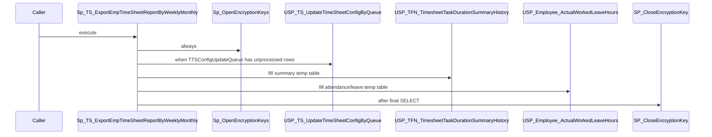
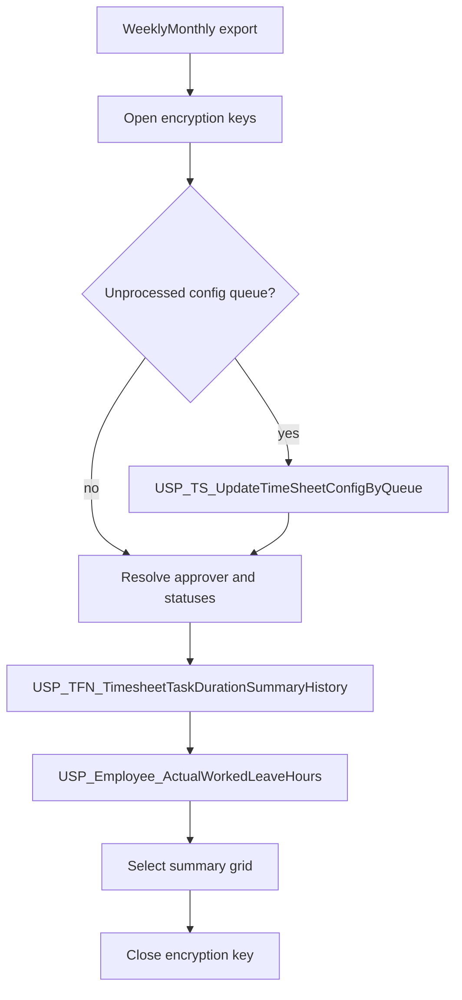

# Sp_TS_ExportEmpTimeSheetReportByWeeklyMonthly

## What it does

Builds the TimeSheet Export summary grid for a date range and review frequency (weekly/bi-weekly/etc.). Opens encryption keys, optionally drains `TTSConfigUpdateQueue`, resolves whether the caller is an approver, loads task-duration summary history into a temp table, enriches with actual worked/leave minutes, and returns submitted/approved project-config rows with capacity and duration breakdowns.

## Parameters

| Name | Direction | What it is for |
|---|---|---|
| `@EmployerId` | in | Primary employer context for role lookup |
| `@EmployerIds` | in | Comma-separated employers passed into summary history |
| `@EmployeeId` | in | Signed-in employee (approver resolution) |
| `@Frequency` | in | Review frequency (`W` default) |
| `@PFromDate` / `@PTodate` | in | Inclusive date range |
| `@BusinessUnit` | in | Unused in live body (accepted) |
| `@ProjectId` / `@ClientId` | in | Optional project/client filters |
| `@ProjectOrgIds` / `@ClientOrgIds` | in | Accepted; not applied in the active SELECT body |
| `@PageNumber` / `@PageSize` / `@FilterJson` | in | Pagination inputs; formatted-pagination path is commented out |

## Call sequence

## Callers

Application: TimePort `ExportEmpTimeSheetReportByWeeklyMonthly` from TimeSheet Export search. No other procedure or function calls this object.

## Nested

| Object | Kind | When | Page |
|---|---|---|---|
| `Sp_OpenEncryptionKeys` | procedure | always | [Sp_OpenEncryptionKeys](/docs/database/hrms/Sp_OpenEncryptionKeys) |
| `USP_TS_UpdateTimeSheetConfigByQueue` | procedure | unprocessed queue rows | [USP_TS_UpdateTimeSheetConfigByQueue](/docs/database/hrm-timeport/USP_TS_UpdateTimeSheetConfigByQueue) |
| `TFN_DateRangeByReportType` | function | build `#DateRange` | [TFN_DateRangeByReportType](/docs/database/hrm-timeport/TFN_DateRangeByReportType) |
| `USP_TFN_TimesheetTaskDurationSummaryHistory` | procedure | always | [USP_TFN_TimesheetTaskDurationSummaryHistory](/docs/database/hrm-timeport/USP_TFN_TimesheetTaskDurationSummaryHistory) |
| `USP_Employee_ActualWorkedLeaveHours` | procedure | always | [USP_Employee_ActualWorkedLeaveHours](/docs/database/hrm-timeport/USP_Employee_ActualWorkedLeaveHours) |
| `Fn_GetEmployeeName` | function | SELECT employee/approver names | [Fn_GetEmployeeName](/docs/database/hrms/Fn_GetEmployeeName) |
| `UFN_GetClientbyEmployeeBU` | function | join clients for `@EmployeeID` | [UFN_GetClientbyEmployeeBU](/docs/database/hrms/UFN_GetClientbyEmployeeBU) |
| `FN_ConvertMinutesToHHMM` | function | format attendance/leave hours | [FN_ConvertMinutesToHHMM](/docs/database/hrms/FN_ConvertMinutesToHHMM) |
| `SP_CloseEncryptionKey` | procedure | after SELECT | [SP_CloseEncryptionKey](/docs/database/hrms/SP_CloseEncryptionKey) |

## Steps

1. `SET NOCOUNT ON` and `READ UNCOMMITTED`; execute `Sp_OpenEncryptionKeys`.
2. If `TTSConfigUpdateQueue` has `IsProcessed = 0`, exec `USP_TS_UpdateTimeSheetConfigByQueue`.
3. Resolve Submitted/Approved status ids from `TSEmpTimesheetStatus`.
4. If `@EmployeeId` is set, resolve `@ApproverId` from user role `ReportingType` (non 1/2 → employee is approver).
5. Build `#DateRange` from `TFN_DateRangeByReportType` (temp is created; summary SP also uses the date inputs).
6. Exec `USP_TFN_TimesheetTaskDurationSummaryHistory` into `#TimesheetTaskDurationSummaryHistory`.
7. Aggregate employee ids and exec `USP_Employee_ActualWorkedLeaveHours` into `#EmployeeActualWorkedLeaveInfo`.
8. Select distinct summary rows joined to `TTSProjectConfiguration` (submitted without approver or approved with approver), `TEmployeeInfo`, `UFN_GetClientbyEmployeeBU`, `TProject`, `TClient`, and leave/attendance hours.
9. Exec `SP_CloseEncryptionKey`.

## Tables

| Table | Read or write |
|---|---|
| `TTSConfigUpdateQueue` | read |
| `TSEmpTimesheetStatus` | read |
| `tuseremployee` / `tusers` / `troles` | read |
| `TTSProjectConfiguration` | read |
| `TEmployeeInfo` | read |
| `TProject` / `TClient` | read |

## Flow

