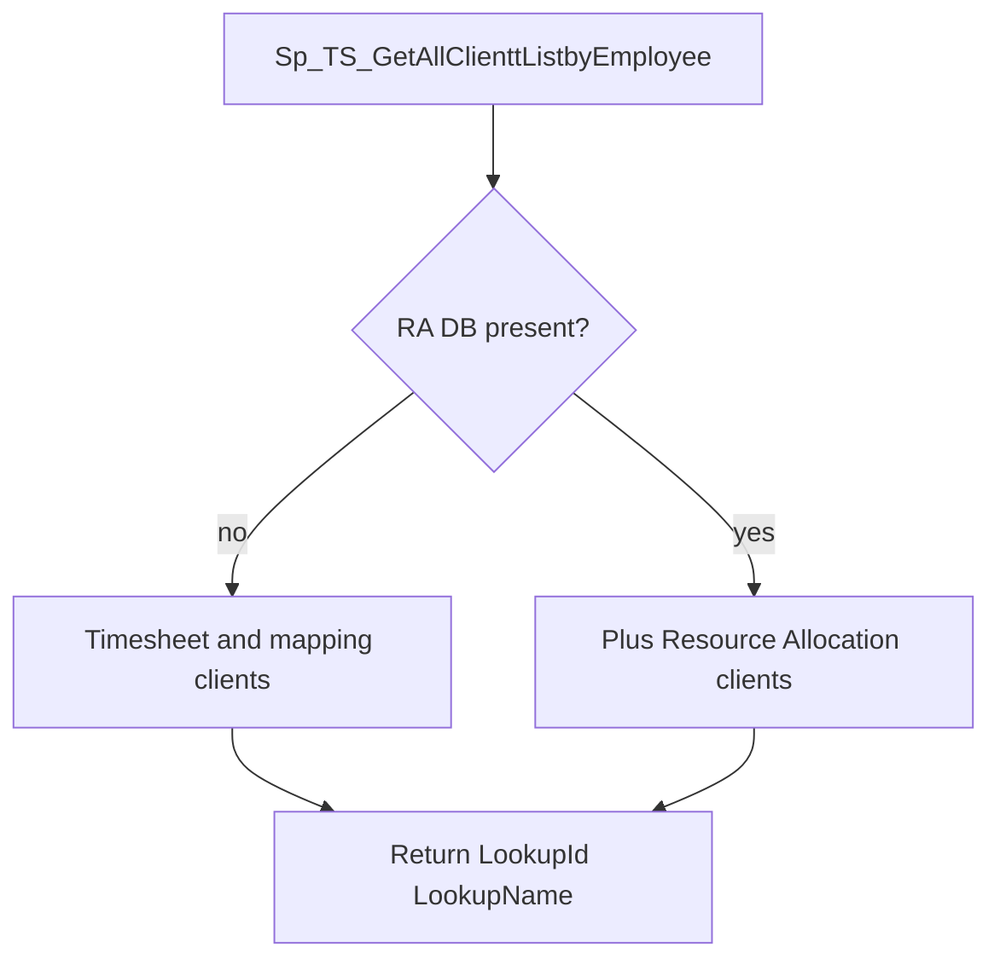

# Sp_TS_GetAllClienttListbyEmployee

## What it does

Returns distinct clients for the TimeSheet Status client filter for an employee across employer ids. Clients are those linked through the employee’s timesheet projects or `TTSUserProjectMapping` project configs (with an optional Resource Allocation branch). Object name keeps the historical `Clientt` spelling used by the DAL.

## Parameters

| Name | Direction | What it is for |
|---|---|---|
| `@pEmployerId` | in | Comma-separated employer ids |
| `@pEmployeeid` | in | Employee whose clients to list |

## Call sequence

Calls no other procedures or functions.

## Callers

Application: TimePort `GetAllClientListByEmployee` (TimeSheet Status search). No other procedure inventoried as a caller in this pass.

## Nested

Calls no other procedures or functions.

## Steps

1. Detect whether `HRMS_RESOURCEALLOCATION` exists on the server.
2. If not, select clients from `TClient` that appear via `TTSEmpTimeSheet` → `TClientProjectMapping` or via mapped `TTSProjectConfiguration.ClientId`.
3. If the RA database exists, use the alternate union that includes Resource Allocation client codes.
4. Order by display name (`ClientName-EmployerName`).

## Tables

| Table | Read or write |
|---|---|
| `TClient` | read |
| `TEmployerdetails` | read |
| `TTSEmpTimeSheet` | read |
| `TClientProjectMapping` | read |
| `TTSProjectConfiguration` | read |
| `TTSUserProjectMapping` | read |
| `HRM_RESOURCEALLOCATION.dbo.TRESOURCEALLOCATION` | read (conditional branch; name as in script) |

## Unresolved calls

None.

## Flow

