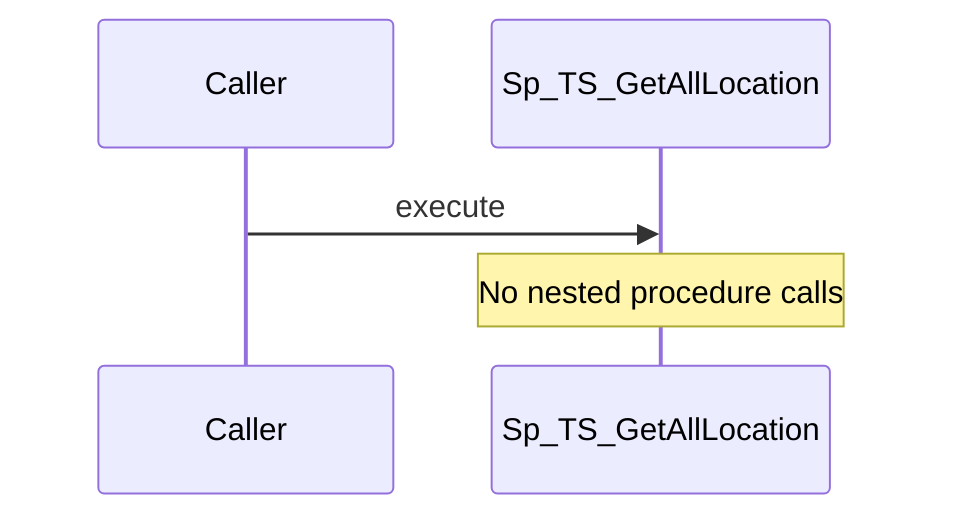
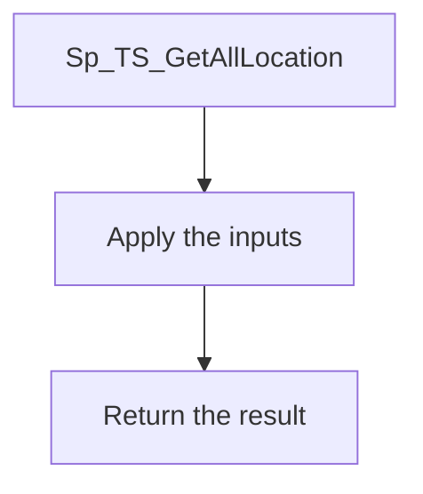

# Sp_TS_GetAllLocation

## What it does

Returns TimePort location lookup values (`Lookup_Parent_ID = 5000`) for the employer location dropdown.

## Parameters

| Name | Direction | What it is for |
|---|---|---|
| `@pEmployerId` | in | Employer id |

## Call sequence

## Callers

Application caller: TimePort API `GetAllLocation` for TimePort → TimeSheet.

## Nested

| Object | Kind | When | Page |
|---|---|---|---|
| _(none)_ | — | — | — |

## Steps

In `HRMS-DATABASE/HRM-TIMEPORT/STOREPROCEDURE/Sp_TS_GetAllLocation.sql`:

1. Select distinct location lookup rows from `TTSLOOKUP` for parent 5000 where not deleted.

## Tables

| Table | Read or write |
|---|---|
| `TTSLOOKUP` | read |

## Unresolved calls

None identified beyond the nested objects listed above.

## Flow

