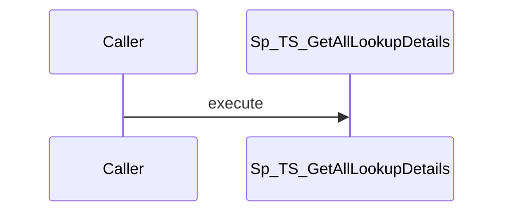
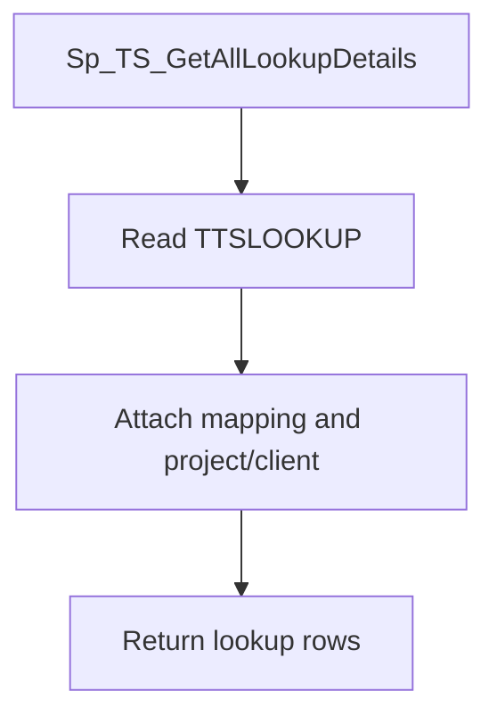

# Sp_TS_GetAllLookupDetails

## What it does

Returns TimePort lookup rows for an employer with parent text and project/client billable/time-off metadata from `TTSLookUpMapping` and project configuration.

## Parameters

| Name | Direction | What it is for |
|---|---|---|
| `@pEmployerId` | in | Employer |

## Call sequence

## Callers

No other procedure or function under STOREPROCEDURE or FUNCTIONS executes this object. Application caller: TimePort DAL `GetAllLookupDetails`.

## Nested

Calls no other procedures or functions.

## Steps

In `HRMS-DATABASE/HRM-TIMEPORT/STOREPROCEDURE/Sp_TS_GetAllLookupDetails.sql`:

1. Select from `TTSLOOKUP` for the employer.
2. OUTER APPLY project configuration + lookup mapping to attach project/client/billable flags.
3. Return distinct lookup rows for filter dropdowns.

## Tables

| Table | Read or write |
|---|---|
| `TTSLOOKUP` | read |
| `TTSProjectConfiguration` | read |
| `TTSLookUpMapping` | read |
| `TProject` / `TClient` | read |

## Flow

