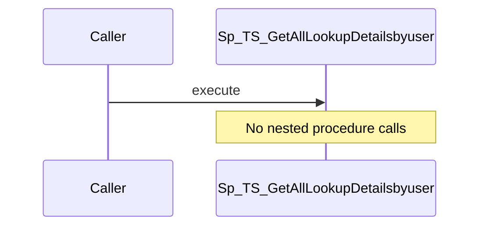
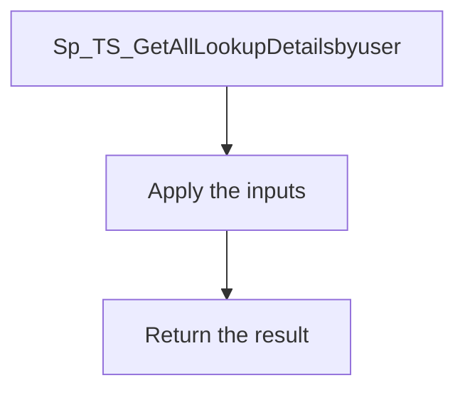

# Sp_TS_GetAllLookupDetailsbyuser

## What it does

Returns project-scoped lookup values (SDLC, work item, work product, and related mappings) effective as of a date, using temporal `TTSLookUpMapping`.

## Parameters

| Name | Direction | What it is for |
|---|---|---|
| `@pEmployerId` | in | Employer id |
| `@ProjectConfigId` | in | Project configuration id (UI may send as Projectid) |
| `@EffectiveUntil` | in | Effective date for temporal mapping |

## Call sequence

## Callers

Application caller: TimePort API `GetAllLookupDetailsbyuser` for TimePort → TimeSheet row dropdowns.

## Nested

| Object | Kind | When | Page |
|---|---|---|---|
| _(none)_ | — | — | — |

## Steps

In `HRMS-DATABASE/HRM-TIMEPORT/STOREPROCEDURE/Sp_TS_GetAllLookupDetailsbyuser.sql`:

1. Materialise temporal `#LookUpMapping` for the ProjectConfigId.
2. Compute deleted-on dates and return active lookup details for the effective date.

## Tables

| Table | Read or write |
|---|---|
| `TTSLookUpMapping` | read |
| `TTSLOOKUP` | read |

## Unresolved calls

None identified beyond the nested objects listed above.

## Flow

