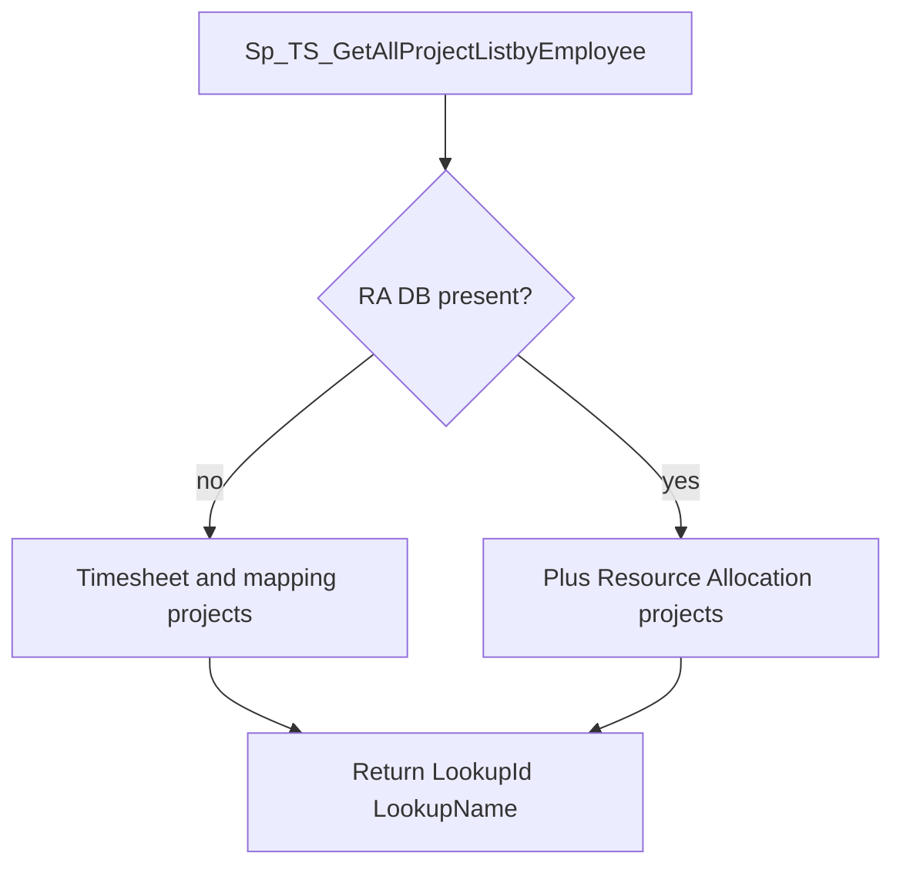

# Sp_TS_GetAllProjectListbyEmployee

## What it does

Returns distinct projects available in the TimeSheet Status project filter for an employee across one or more employers, optionally narrowed by client ids / client-org composites. Projects come from timesheet history and `TTSUserProjectMapping` (and a Resource Allocation branch when that database exists).

## Parameters

| Name | Direction | What it is for |
|---|---|---|
| `@pEmployerId` | in | Comma-separated employer ids |
| `@pEmployeeid` | in | Employee whose projects to list |
| `@ClientId` | in | Optional client id list |
| `@ClientOrgIds` | in | Optional `ClientId+EmployerId` composite filter |

## Call sequence

Calls no other procedures or functions.

## Callers

Application: TimePort `GetAllProjectListbyEmployee` (TimeSheet Status search). No other procedure inventoried as a caller in this pass.

## Nested

Calls no other procedures or functions.

## Steps

1. Detect whether `HRMS_RESOURCEALLOCATION_UAT` exists on the server.
2. If not, select projects from `TProject` joined to employer/client mapping where the project appears in `TTSEmpTimeSheet` or mapped `TTSProjectConfiguration` for the employee.
3. If the RA database exists, use the alternate branch that also unions Resource Allocation project codes.
4. Apply client and client-org filters; order by display name.

## Tables

| Table | Read or write |
|---|---|
| `TProject` | read |
| `TEmployerdetails` | read |
| `TClientProjectMapping` | read |
| `TClient` | read |
| `TTSEmpTimeSheet` | read |
| `TTSProjectConfiguration` | read |
| `TTSUserProjectMapping` | read |
| `HRMS_RESOURCEALLOCATION_UAT.dbo.TRESOURCEALLOCATION` | read (conditional branch) |

## Unresolved calls

None.

## Flow

