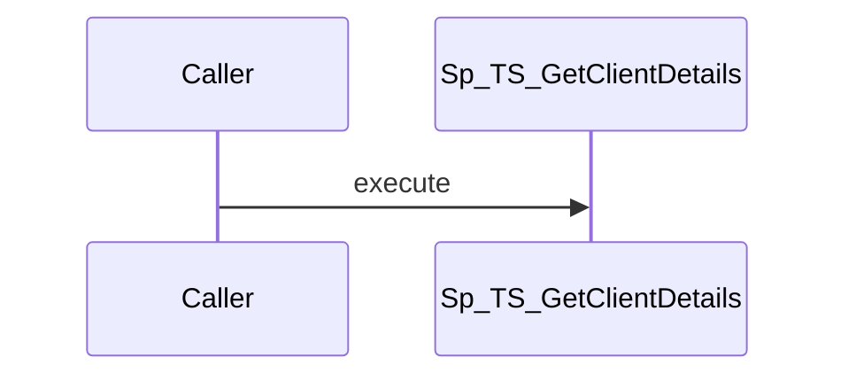
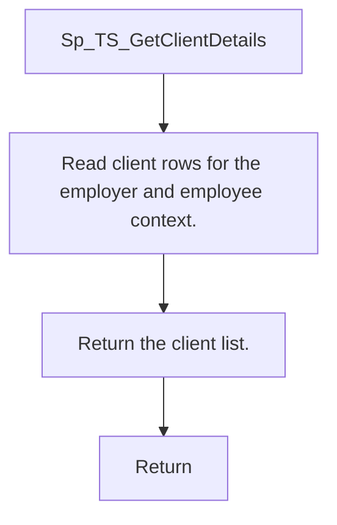

# Sp_TS_GetClientDetails

## What it does

Returns clients available to the employee for TimePort master screens.

## Parameters

| Name | Direction | What it is for |
|---|---|---|
| `@pEmployerId` | in | Employer id |
| `@pEmployeeid` | in | Employee id |

## Call sequence

## Callers

Application only. timeportDAL.GetClientDetails.

## Nested

This object does not execute another procedure or user-defined function.

## Steps

In `HRMS-DATABASE/HRM-TIMEPORT/STOREPROCEDURE/Sp_TS_GetClientDetails.sql`:

1. Read client rows for the employer and employee context.
2. Return the client list.

## Tables

| Table | Read or write |
|---|---|
| `TClient` | read |

## Unresolved calls

None recorded for this page.

## Flow

