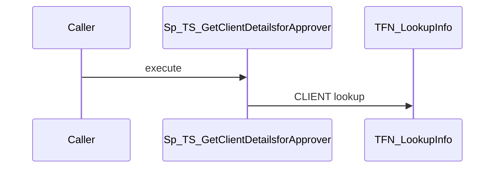
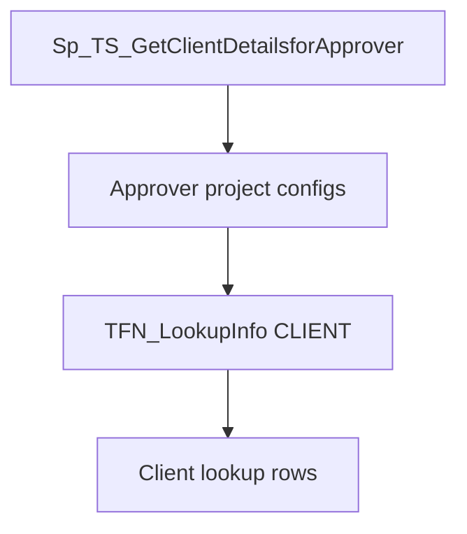

# Sp_TS_GetClientDetailsforApprover

## What it does

Lists clients for projects where the employee is TimeSheetApprover, labeled via `TFN_LookupInfo('CLIENT', ...)` and employer name, filtered by comma-separated employer ids.

## Parameters

| Name | Direction | What it is for |
|---|---|---|
| `@pEmployerId` | in | Comma-separated employers |
| `@pEmployeeid` | in | Approver |

## Call sequence

## Callers

No other procedure or function under STOREPROCEDURE or FUNCTIONS executes this object. Application caller: TimePort DAL `GetClientDetailsforApprover`.

## Nested

| Object | Kind | When | Page |
|---|---|---|---|
| `TFN_LookupInfo` | function | CROSS APPLY CLIENT | [TFN_LookupInfo](/docs/database/hrm-timeport/TFN_LookupInfo) |

## Steps

In `HRMS-DATABASE/HRM-TIMEPORT/STOREPROCEDURE/Sp_TS_GetClientDetailsforApprover.sql`:

1. Temporal project configs CROSS APPLY user mappings for the approver.
2. Resolve client label with `TFN_LookupInfo('CLIENT', ...)`.
3. Filter employers from `string_split(@pEmployerId, ',')`.

## Tables

| Table | Read or write |
|---|---|
| `TTSProjectConfiguration` | read |
| `TTSUserProjectMapping` | read |
| `TemployerDetails` | read |

## Flow

