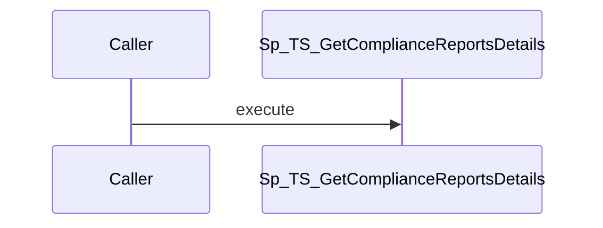
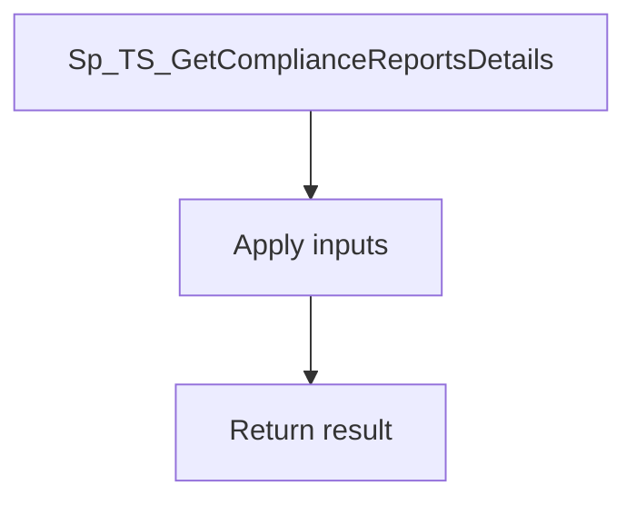

# Sp_TS_GetComplianceReportsDetails

## What it does

Compliance drill-down for one employee/employer and date range: day-level timesheet lines with project, SDLC, WIT, location, status, and capacity columns.

## Parameters

| Name | Direction | What it is for |
|---|---|---|
| `@pEmployeeId` | in | Subject employee |
| `@pEmployerId` | in | Employer |
| `@PFromDate` | in | Range start |
| `@PTodate` | in | Range end |
| `@ClientId` | in | Optional client CSV |
| `@LoginEmpID` | in | Login employee for BU scope |
| `@BusinessUnit` | in | Optional BU CSV |

## Call sequence

## Callers

| Object | Kind | Page |
|---|---|---|
| `_application_` | TimePort API | [Report guide](/docs/guides/timeport/report) |

## Nested

| Object | Kind | When | Page |
|---|---|---|---|
| `Sp_OpenEncryptionKeys` | procedure | start | [Sp_OpenEncryptionKeys](/docs/database/hrms/Sp_OpenEncryptionKeys) |
| `SP_AdminWM_GetBusinessUnitByOrgEmployeeId` | procedure | optional BU (may be commented) | [SP_AdminWM_GetBusinessUnitByOrgEmployeeId](/docs/database/hrms/SP_AdminWM_GetBusinessUnitByOrgEmployeeId) |
| `USP_EmployeeTotalCapacity` | procedure | capacity windows | [USP_EmployeeTotalCapacity](/docs/database/hrm-timeport/USP_EmployeeTotalCapacity) |
| `USP_EmployeeTotalCapacityByProject` | procedure | project capacity | [USP_EmployeeTotalCapacityByProject](/docs/database/hrm-timeport/USP_EmployeeTotalCapacityByProject) |
| `SP_CloseEncryptionKey` | procedure | end | [SP_CloseEncryptionKey](/docs/database/hrms/SP_CloseEncryptionKey) |

## Steps

In `HRMS-DATABASE/HRM-TIMEPORT/STOREPROCEDURE/Sp_TS_GetComplianceReportsDetails.sql`:

1. Open encryption keys.
2. Materialize `#TimeSheet1` from timesheet + project + lookup.
3. Call capacity helpers for range / day UDTs.
4. Return detail rows; close keys.

## Tables

| Table | Read or write |
|---|---|
| `TTSEmpTimeSheet` | read |
| `TProject` | read |
| `TTSLOOKUP` | read |
| `TEmployee` | read |
| `TClient` | read |

## Flow

