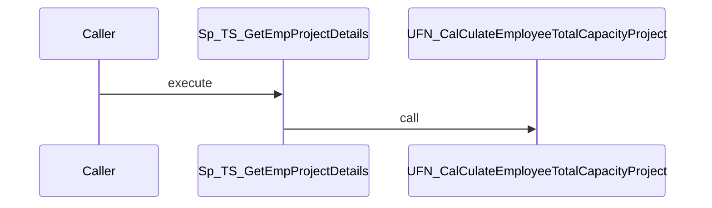
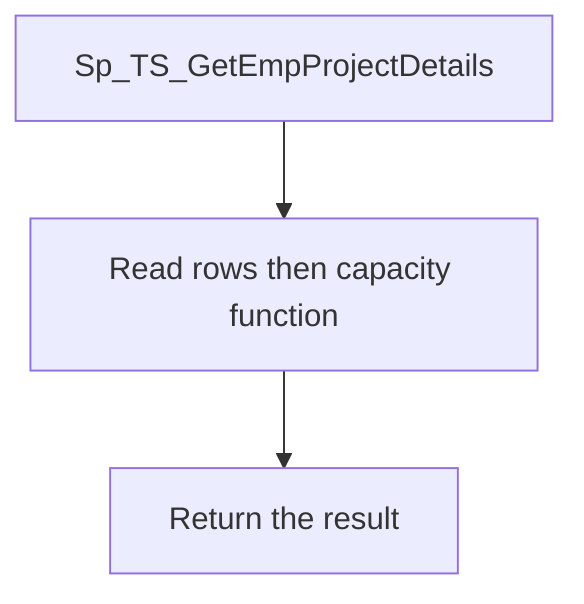

# Sp_TS_GetEmpProjectDetails

## What it does

Loads existing timesheet task rows for an employee and date range with project/lookup names, reject reason, sync flags, and allocated hours via `UFN_CalCulateEmployeeTotalCapacityProject`. Also returns capacity and attendance-related result sets used by Daily/Weekly entry.

## Parameters

| Name | Direction | What it is for |
|---|---|---|
| `@pEmployerId` | in | Employer id |
| `@pEmployeeId` | in | Employee id |
| `@PStartDate` | in | Range start |
| `@PEndDate` | in | Range end |

## Call sequence

## Callers

Application caller: TimePort API `GetEmpProjectDetails` for TimePort → TimeSheet Daily/Weekly grids.

## Nested

| Object | Kind | When | Page |
|---|---|---|---|
| `UFN_CalCulateEmployeeTotalCapacityProject` | function | Per timesheet row allocated hours | [UFN_CalCulateEmployeeTotalCapacityProject](/docs/database/hrm-timeport/UFN_CalCulateEmployeeTotalCapacityProject) |

## Steps

In `HRMS-DATABASE/HRM-TIMEPORT/STOREPROCEDURE/Sp_TS_GetEmpProjectDetails.sql`:

1. Select active timesheet rows from `TTSEmpTimeSheet` joined to `TProject` and lookup names.
2. Call `UFN_CalCulateEmployeeTotalCapacityProject` for allocated hours.
3. Return additional capacity / attendance result sets used by the UI.

## Tables

| Table | Read or write |
|---|---|
| `TTSEmpTimeSheet` | read |
| `TProject` | read |
| `TTSLOOKUP` | read |
| `TSEmpTimesheetStatus` | read |

## Unresolved calls

None identified beyond the nested objects listed above.

## Flow

