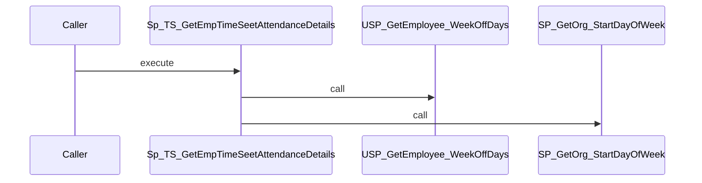
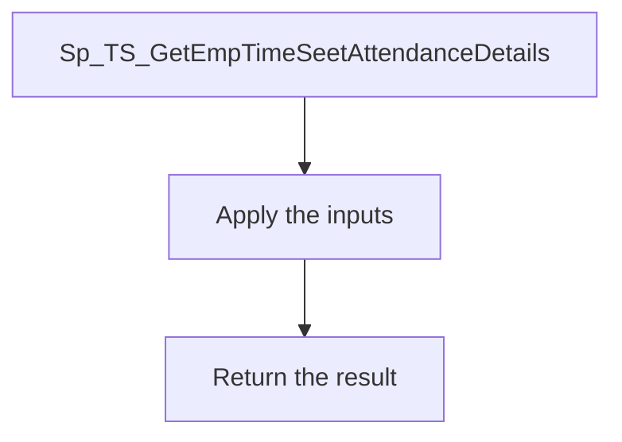

# Sp_TS_GetEmpTimeSeetAttendanceDetails

## What it does

Returns worked-hours / attendance detail for a date range on the Daily tab, then week-off days and org start day of week (same nested pair as month-wise).

## Parameters

| Name | Direction | What it is for |
|---|---|---|
| `@EmployerId` | in | Employer id |
| `@pEmployeeID` | in | Employee id |
| `@PFromDate` | in | Range start |
| `@PTodate` | in | Range end |

## Call sequence

## Callers

Application caller: TimePort API `GetEmpTimeSeetAttendanceDetails` for TimePort → TimeSheet Daily attendance strip.

## Nested

| Object | Kind | When | Page |
|---|---|---|---|
| `USP_GetEmployee_WeekOffDays` | procedure | Called while this object runs | [USP_GetEmployee_WeekOffDays](/docs/database/hrms/USP_GetEmployee_WeekOffDays) |
| `SP_GetOrg_StartDayOfWeek` | procedure | Called while this object runs | [SP_GetOrg_StartDayOfWeek](/docs/database/hrms/SP_GetOrg_StartDayOfWeek) |

## Steps

In `HRMS-DATABASE/HRM-TIMEPORT/STOREPROCEDURE/Sp_TS_GetEmpTimeSeetAttendanceDetails.sql`:

1. Select duration/attendance rows via `TFN_TimesheetTaskDurationSummaryHistory_status`.
2. Select attendance minutes converted with `FN_ConvertMinutesToHHMM`.
3. EXEC week-off and start-day procedures.

## Tables

| Table | Read or write |
|---|---|
| `TTSEmpTimeSheet` | read (via TVF) |
| `Attendance-related synonym tables` | read |

## Unresolved calls

None identified beyond the nested objects listed above.

## Flow

