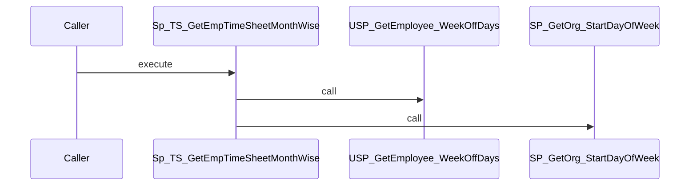
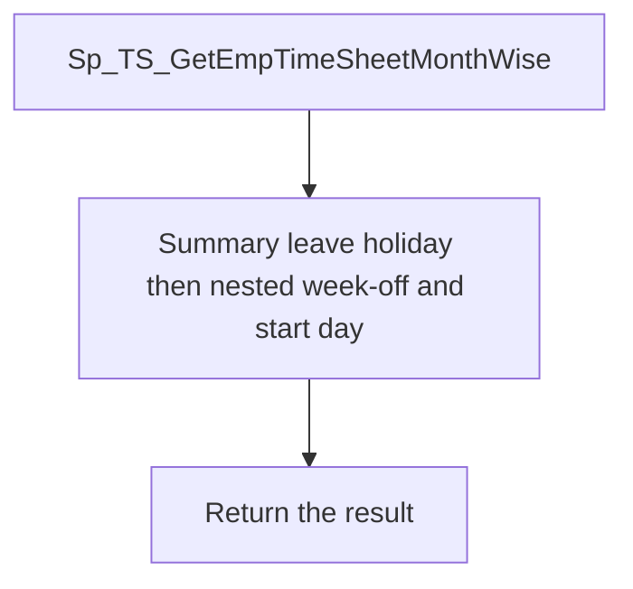

# Sp_TS_GetEmpTimeSheetMonthWise

## What it does

Builds the month calendar payload for TimeSheet: daily duration summary, leave days, holidays, week-off days, and organisation start day of week.

## Parameters

| Name | Direction | What it is for |
|---|---|---|
| `@EmployerId` | in | Employer id |
| `@EmployeeId` | in | Employee id |
| `@Month` | in | Month number |
| `@Year` | in | Year |
| `@ToDate` | in | Optional end-of-month override |

## Call sequence

## Callers

Application caller: TimePort API `GetEmpTimeSheetMonthWise` for TimePort → TimeSheet calendar and router StartDayOfWeek.

## Nested

| Object | Kind | When | Page |
|---|---|---|---|
| `USP_GetEmployee_WeekOffDays` | procedure | After leave/holiday selects | [USP_GetEmployee_WeekOffDays](/docs/database/hrms/USP_GetEmployee_WeekOffDays) |
| `SP_GetOrg_StartDayOfWeek` | procedure | Final result set for week start | [SP_GetOrg_StartDayOfWeek](/docs/database/hrms/SP_GetOrg_StartDayOfWeek) |

## Steps

In `HRMS-DATABASE/HRM-TIMEPORT/STOREPROCEDURE/Sp_TS_GetEmpTimeSheetMonthWise.sql`:

1. Compute month date range from Month/Year/ToDate.
2. Select duration summary via `TFN_TimesheetTaskDurationSummaryHistory_status`.
3. Select leave days and holidays for the employee.
4. EXEC `USP_GetEmployee_WeekOffDays` then `SP_GetOrg_StartDayOfWeek`.

## Tables

| Table | Read or write |
|---|---|
| `TTSEmpTimeSheet` | read (via TVF) |
| `TLeaveRequestDays` | read |
| `TLeaveTypeMaster` | read |
| `temployeeinfo` | read |
| `tholidaymaster` | read |
| `Toptionalholidayrequest` | read |

## Unresolved calls

None identified beyond the nested objects listed above.

## Flow

