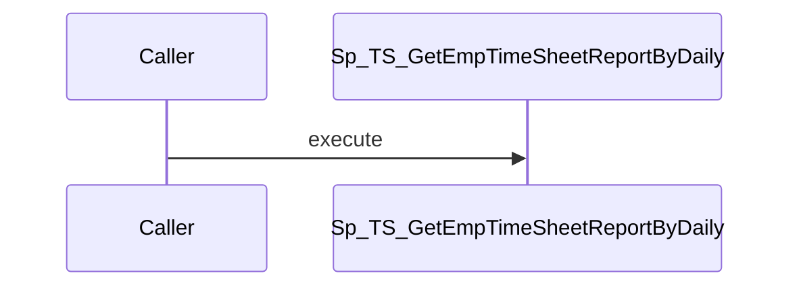
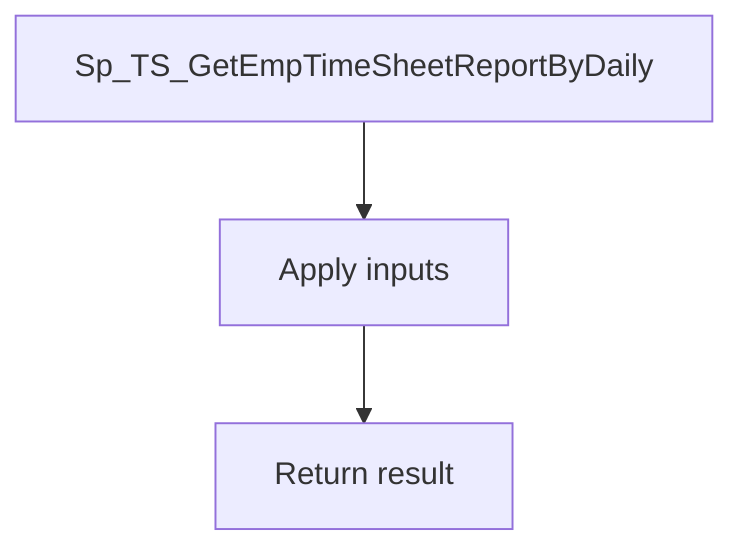

# Sp_TS_GetEmpTimeSheetReportByDaily

## What it does

Older daily timesheet report procedure still executed from ComplianceSearch via `getemptimesheetreportbydaily`. Project Hours Daily now prefers Summary/Detail USPs.

## Parameters

| Name | Direction | What it is for |
|---|---|---|
| `@PFromDate` | in | Range start |
| `@PTodate` | in | Range end |
| `@BusinessUnit` | in | BU CSV |
| `@ProjectId` | in | Project CSV |
| `@EmpId` | in | Employee scope |
| `@EmployerId` | in | Employer |
| `@employerIds` | in | Employer CSV (API) |
| `@ClientId` | in | Client CSV |
| `@ReportType` | in | Report type |
| `@TsStatus` | in | Status CSV |
| `@InActiveEmployee` | in | Include inactive |
| `@ProjectOrgIds` | in | Project-org CSV |
| `@ClientOrgIds` | in | Client-org CSV |
| `@WorkItemTypeIds` | in | WIT CSV |

## Call sequence

## Callers

| Object | Kind | Page |
|---|---|---|
| `_application_` | TimePort API | [Report guide](/docs/guides/timeport/report) |

## Nested

| Object | Kind | When | Page |
|---|---|---|---|
| `Sp_OpenEncryptionKeys` | procedure | start | [Sp_OpenEncryptionKeys](/docs/database/hrms/Sp_OpenEncryptionKeys) |

## Steps

In `HRMS-DATABASE/HRM-TIMEPORT/STOREPROCEDURE/Sp_TS_GetEmpTimeSheetReportByDaily.sql`:

1. Open encryption keys.
2. Select filtered daily timesheet rows with project/client/employee labels.
3. Return rows for Node post-filter of editable-by-approver clones.

## Tables

| Table | Read or write |
|---|---|
| `TTSEmpTimeSheet` | read |
| `TProject` | read |
| `TClient` | read |
| `TEmployee` | read |
| `TEmployerDetails` | read |

## Flow

