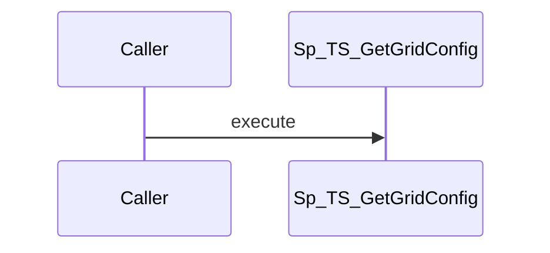
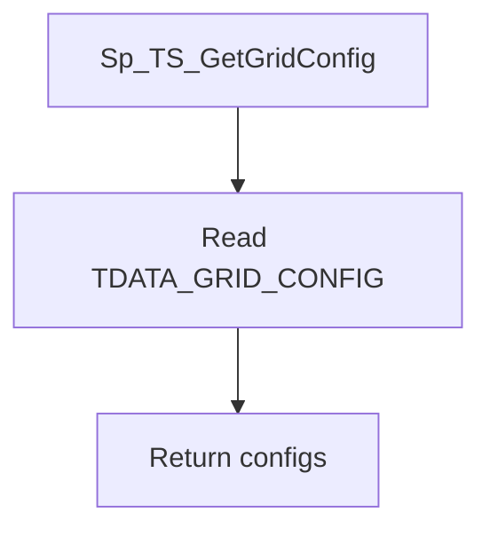

# Sp_TS_GetGridConfig

## What it does

Reads saved grid configuration rows for one employee and grid id from `TDATA_GRID_CONFIG` (column layout / default search JSON).

## Parameters

| Name | Direction | What it is for |
|---|---|---|
| `@pEmployeeId` | in | Employee who owns the config |
| `@pGridId` | in | Grid key (e.g. TimeSheetApproverSummery_Grid) |

## Call sequence

## Callers

No other procedure or function under STOREPROCEDURE or FUNCTIONS executes this object. Application caller: TimePort DAL `GetGridConfig`.

## Nested

Calls no other procedures or functions.

## Steps

In `HRMS-DATABASE/HRM-TIMEPORT/STOREPROCEDURE/Sp_TS_GetGridConfig.sql`:

1. Select ConfigId, EmployeeId, GridId, ConfigType, Config from `TDATA_GRID_CONFIG` for the employee and grid.

## Tables

| Table | Read or write |
|---|---|
| `TDATA_GRID_CONFIG` | read |

## Flow

