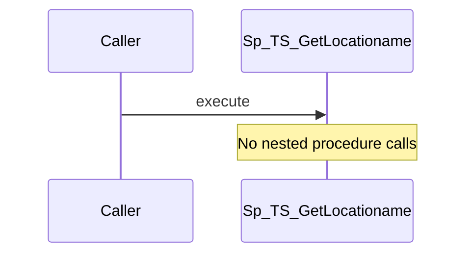
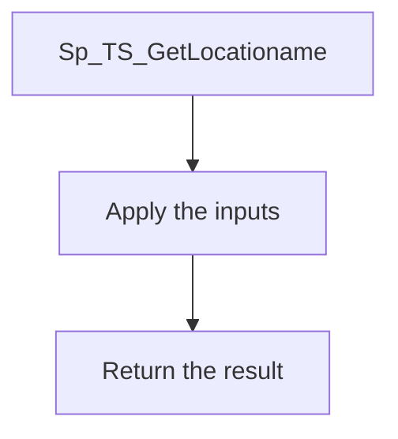

# Sp_TS_GetLocationame

## What it does

Returns the employee’s default Resource Allocation location (RAS) for pre-filling the timesheet location field. Reads Resource Allocation tables via three-part names.

## Parameters

| Name | Direction | What it is for |
|---|---|---|
| `@EmployerId` | in | Employer id |
| `@EmployeeID` | in | Employee id |

## Call sequence

## Callers

Application caller: TimePort API `GetLocationame` for TimePort → TimeSheet.

## Nested

| Object | Kind | When | Page |
|---|---|---|---|
| _(none)_ | — | — | — |

## Steps

In `HRMS-DATABASE/HRM-TIMEPORT/STOREPROCEDURE/Sp_TS_GetLocationame.sql`:

1. Join Resource Allocation `TEMPLOYEEINFO` / `TEMPLOYEE` / `TRESOURCEALLOCATION`.
2. Resolve location text from `TLOOKUP` parent 1100.

## Tables

| Table | Read or write |
|---|---|
| `[HRM_ResourceAllocation].dbo.TEMPLOYEEINFO` | read |
| `[HRM_ResourceAllocation].dbo.TEMPLOYEE` | read |
| `[HRM_ResourceAllocation].dbo.TRESOURCEALLOCATION` | read |
| `TLOOKUP` | read |

## Unresolved calls

None identified beyond the nested objects listed above.

## Flow

