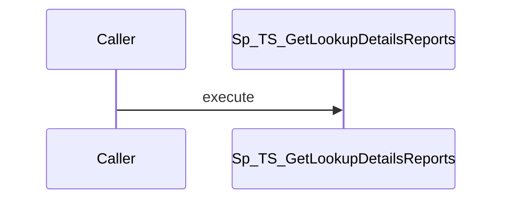
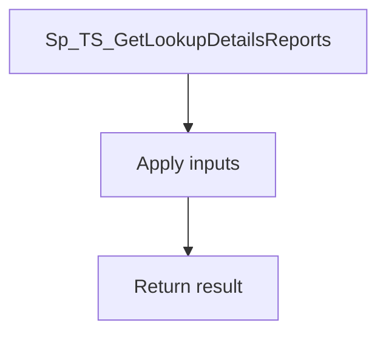

# Sp_TS_GetLookupDetailsReports

## What it does

Returns lookup mapping rows for a CSV of `ProjectConfigId` values used to label report columns / filters.

## Parameters

| Name | Direction | What it is for |
|---|---|---|
| `@ProjectConfigIds` | in | Comma-separated project config ids |

## Call sequence

## Callers

| Object | Kind | Page |
|---|---|---|
| `_application_` | TimePort API | [Report guide](/docs/guides/timeport/report) |

## Nested

| Object | Kind | When | Page |
|---|---|---|---|
| — | — | — | — |

## Steps

In `HRMS-DATABASE/HRM-TIMEPORT/STOREPROCEDURE/Sp_TS_GetLookupDetailsReports.sql`:

1. Split `@ProjectConfigIds`.
2. Join `TTSLookUpMapping` to project config and lookup / employer.
3. Return lookup id/name rows for the configs.

## Tables

| Table | Read or write |
|---|---|
| `TTSLookUpMapping` | read |
| `TTSProjectConfiguration` | read |
| `TTSLOOKUP` | read |
| `TEmployerdetails` | read |

## Flow

