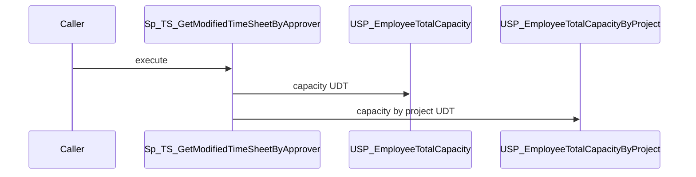
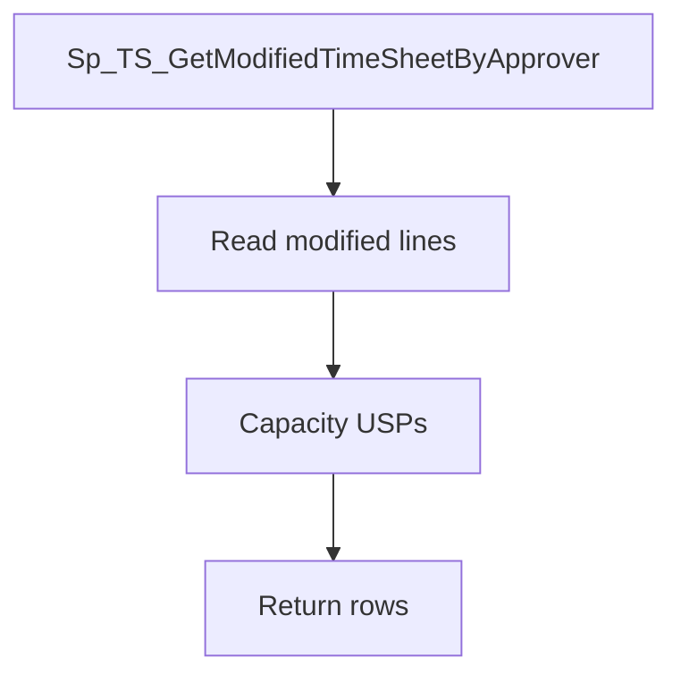

# Sp_TS_GetModifiedTimeSheetByApprover

## What it does

Loads timesheet detail shaped like the approval modal for rows already modified by an approver in the selected period, including capacity via the same nested capacity USPs used by the summary.

## Parameters

| Name | Direction | What it is for |
|---|---|---|
| `@pEmployerId` | in | Employer |
| `@pEmployeeId` | in | Timesheet owner |
| `@pProjectID` | in | Project (optional) |
| `@PFromDate` / `@PTodate` | in | Period |
| `@LoggedInUser` | in | Approver |
| `@TsStatus` | in | Status filter |
| `@pReviewFreq` | in | Review frequency |

## Call sequence

## Callers

No other procedure or function under STOREPROCEDURE or FUNCTIONS executes this object. Application caller: TimePort DAL `GetTSModifedApprovalDet`.

## Nested

| Object | Kind | When | Page |
|---|---|---|---|
| `USP_EmployeeTotalCapacity` | procedure | capacity block | [USP_EmployeeTotalCapacity](/docs/database/hrm-timeport/USP_EmployeeTotalCapacity) |
| `USP_EmployeeTotalCapacityByProject` | procedure | capacity by project | [USP_EmployeeTotalCapacityByProject](/docs/database/hrm-timeport/USP_EmployeeTotalCapacityByProject) |

## Steps

In `HRMS-DATABASE/HRM-TIMEPORT/STOREPROCEDURE/Sp_TS_GetModifiedTimeSheetByApprover.sql`:

1. Select modified-by-approver timesheet lines for the period/project.
2. Build capacity UDT and execute the two capacity USPs.
3. Return detail rows for the UI to detect prior edits.

## Tables

| Table | Read or write |
|---|---|
| `TTSEmpTimeSheet` | read |
| `TTSProjectConfiguration` / lookup tables | read |

## Flow

