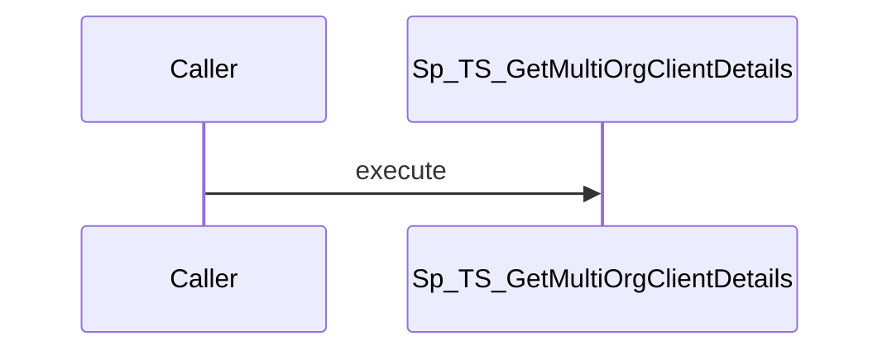
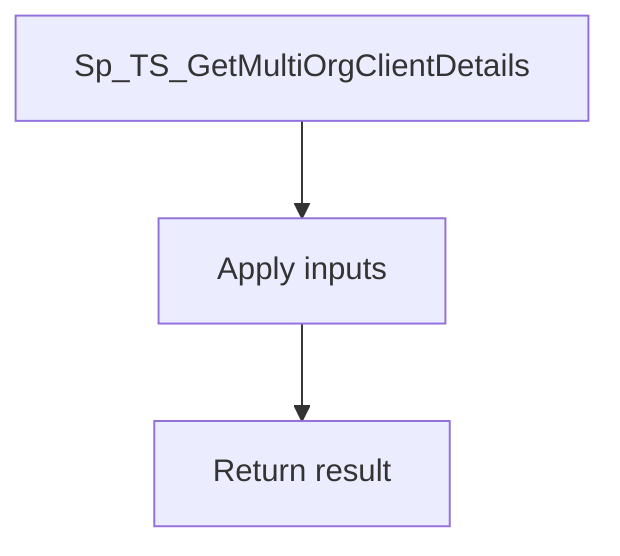

# Sp_TS_GetMultiOrgClientDetails

## What it does

Client picker for multi-org Report filters. Returns distinct clients visible to the employee (BU function / resource-allocation branch) with employer-qualified display names.

## Parameters

| Name | Direction | What it is for |
|---|---|---|
| `@pEmployerId` | in | Employer id CSV |
| `@pEmployeeid` | in | Employee id |
| `@BusinessUnit` | in | Optional BU CSV |

## Call sequence

## Callers

| Object | Kind | Page |
|---|---|---|
| `_application_` | TimePort API | [Report guide](/docs/guides/timeport/report) |

## Nested

| Object | Kind | When | Page |
|---|---|---|---|
| — | — | — | — |

## Steps

In `HRMS-DATABASE/HRM-TIMEPORT/STOREPROCEDURE/Sp_TS_GetMultiOrgClientDetails.sql`:

1. Detect optional RESOURCEALLOCATION database.
2. Select distinct clients via `UFN_GetClientbyEmployeeBU` (or RA branch) filtered by employer/BU.
3. Return LookupId / LookupName / Employerid.

## Tables

| Table | Read or write |
|---|---|
| `TClient` | read |
| `TemployerDetails` | read |

## Flow

