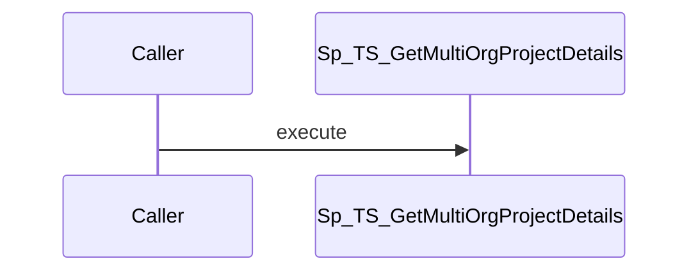
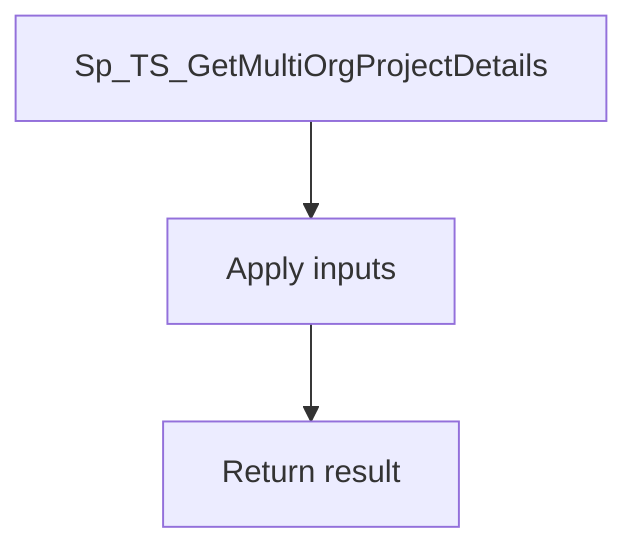

# Sp_TS_GetMultiOrgProjectDetails

## What it does

Project picker for multi-org Report filters. Returns projects (with ProjectConfigId) for selected employers/clients/BUs the employee can see.

## Parameters

| Name | Direction | What it is for |
|---|---|---|
| `@pEmployerId` | in | Employer CSV |
| `@pEmployeeid` | in | Employee id |
| `@ClientId` | in | Client CSV |
| `@ClientOrgIds` | in | Client-org CSV |
| `@BusinessUnit` | in | BU CSV |

## Call sequence

## Callers

| Object | Kind | Page |
|---|---|---|
| `_application_` | TimePort API | [Report guide](/docs/guides/timeport/report) |

## Nested

| Object | Kind | When | Page |
|---|---|---|---|
| — | — | — | — |

## Steps

In `HRMS-DATABASE/HRM-TIMEPORT/STOREPROCEDURE/Sp_TS_GetMultiOrgProjectDetails.sql`:

1. Detect optional RESOURCEALLOCATION database (forced off for employer 11).
2. Join projects to config, client mapping, and employee-BU clients.
3. Filter by employer / client / BU CSVs and return lookup rows.

## Tables

| Table | Read or write |
|---|---|
| `TProject` | read |
| `TTSProjectConfiguration` | read |
| `TClientProjectMapping` | read |
| `TClient` | read |
| `TemployerDetails` | read |

## Flow

