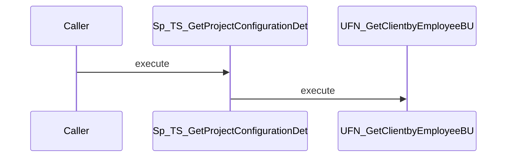
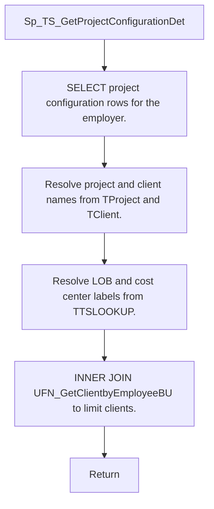

# Sp_TS_GetProjectConfigurationDet

## What it does

Returns the Projects grid for an employer, joining client and project names and filtering clients visible to the employee through UFN_GetClientbyEmployeeBU.

## Parameters

| Name | Direction | What it is for |
|---|---|---|
| `@pEmployerId` | in | Employer id |
| `@pEmployeeID` | in | Login employee id used for client BU filter |

## Call sequence

## Callers

Application only. timeportDAL.GetProjectConfigurationDet.

## Nested

| Object | Kind | Page |
|---|---|---|
| `UFN_GetClientbyEmployeeBU` | function | No page yet |

## Steps

In `HRMS-DATABASE/HRM-TIMEPORT/STOREPROCEDURE/Sp_TS_GetProjectConfigurationDet.sql`:

1. SELECT project configuration rows for the employer.
2. Resolve project and client names from TProject and TClient.
3. Resolve LOB and cost center labels from TTSLOOKUP.
4. INNER JOIN UFN_GetClientbyEmployeeBU to limit clients.

## Tables

| Table | Read or write |
|---|---|
| `TTSProjectConfiguration` | read |
| `TProject` | read |
| `TClient` | read |
| `TTSLOOKUP` | read |

## Unresolved calls

None recorded for this page.

## Flow

