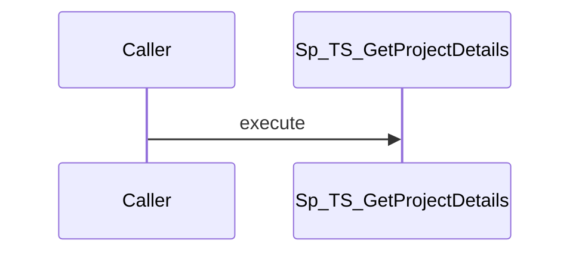
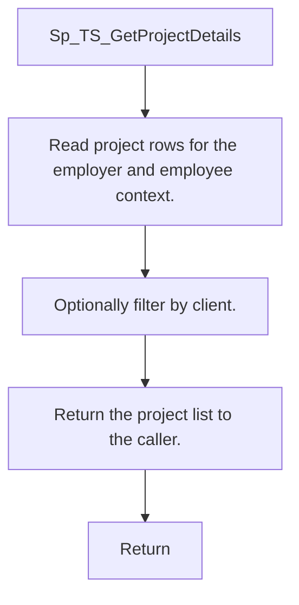

# Sp_TS_GetProjectDetails

## What it does

Returns projects available for TimePort project-configuration dropdowns for an employer, employee, and optional client.

## Parameters

| Name | Direction | What it is for |
|---|---|---|
| `@pEmployerId` | in | Employer id |
| `@pEmployeeid` | in | Employee id |
| `@ClientId` | in | Optional client filter |

## Call sequence

## Callers

Application only. timeportDAL.GetProjectDetails from Setup Master Projects.

## Nested

This object does not execute another procedure or user-defined function.

## Steps

In `HRMS-DATABASE/HRM-TIMEPORT/STOREPROCEDURE/Sp_TS_GetProjectDetails.sql`:

1. Read project rows for the employer and employee context.
2. Optionally filter by client.
3. Return the project list to the caller.

## Tables

| Table | Read or write |
|---|---|
| `TProject` | read |
| `TClient` | read |

## Unresolved calls

None recorded for this page.

## Flow

