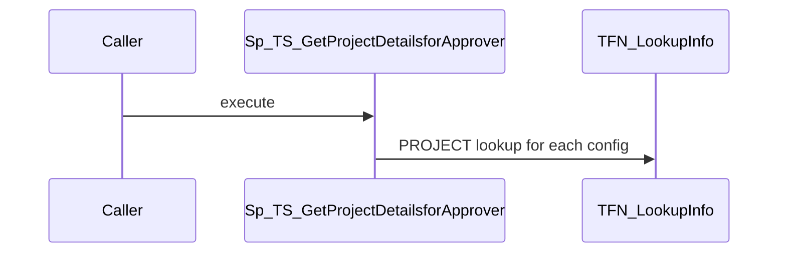
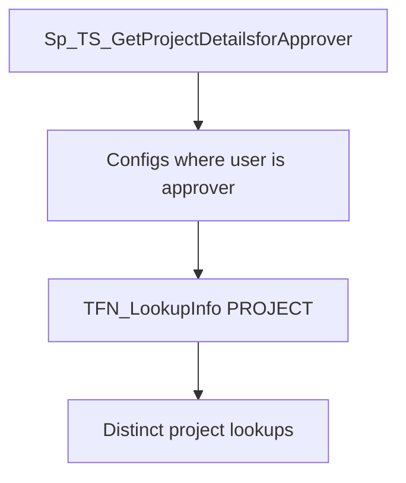

# Sp_TS_GetProjectDetailsforApprover

## What it does

Lists projects (as lookup id/name) where the employee is `TimeSheetApprover` on `TTSUserProjectMapping`, scoped by employer list and optional client / ClientOrgIds filters, using temporal project configuration history.

## Parameters

| Name | Direction | What it is for |
|---|---|---|
| `@pEmployerId` | in | Comma-separated employers |
| `@pEmployeeid` | in | Approver |
| `@ClientId` | in | Optional client id list |
| `@ClientOrgIds` | in | Optional client+org composite keys |
| `@EffectiveUntil` | in | Present in signature; live SELECT path uses temporal ALL |

## Call sequence

## Callers

No other procedure or function under STOREPROCEDURE or FUNCTIONS executes this object. Application caller: TimePort DAL `GetProjectDetailsforApprover`.

## Nested

| Object | Kind | When | Page |
|---|---|---|---|
| `TFN_LookupInfo` | function | OUTER APPLY for PROJECT labels | [TFN_LookupInfo](/docs/database/hrm-timeport/TFN_LookupInfo) |

## Steps

In `HRMS-DATABASE/HRM-TIMEPORT/STOREPROCEDURE/Sp_TS_GetProjectDetailsforApprover.sql`:

1. From temporal `TTSProjectConfiguration` CROSS APPLY mappings where `TimeSheetApprover = @pEmployeeid`.
2. Resolve project label via `TFN_LookupInfo('PROJECT', ...)`.
3. Filter by employer list / client / ClientOrgIds and order by name.

## Tables

| Table | Read or write |
|---|---|
| `TTSProjectConfiguration` | read |
| `TTSUserProjectMapping` | read |
| `TemployerDetails` | read |

## Flow

