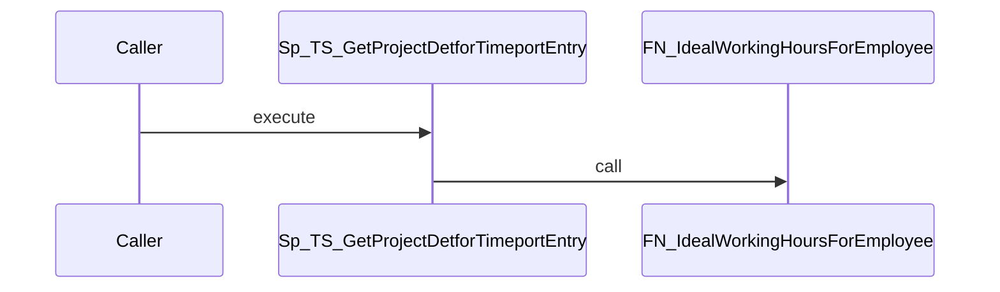
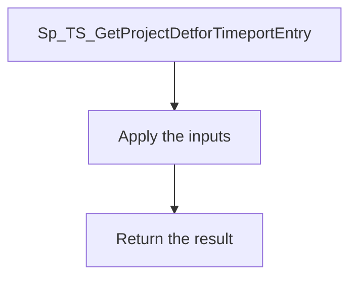

# Sp_TS_GetProjectDetforTimeportEntry

## What it does

Returns projects assigned to the employee for the entry window from temporal `TTSUserProjectMapping` and `TTSProjectConfiguration`, including ideal hours and config flags (attendance, approval, mandatory description).

## Parameters

| Name | Direction | What it is for |
|---|---|---|
| `@pEmployerId` | in | Employer id |
| `@pEmployeeID` | in | Employee id |
| `@Startdate` | in | Optional allocation start filter |
| `@EndDate` | in | Optional allocation end filter |

## Call sequence

## Callers

Application caller: TimePort API `GetProjectDetforTimeportEntry` for TimePort → TimeSheet project dropdowns.

## Nested

| Object | Kind | When | Page |
|---|---|---|---|
| `FN_IdealWorkingHoursForEmployee` | function | Ideal hours per project config | — |

## Steps

In `HRMS-DATABASE/HRM-TIMEPORT/STOREPROCEDURE/Sp_TS_GetProjectDetforTimeportEntry.sql`:

1. Resolve latest user-project mapping rows for the employee and dates.
2. Cross apply latest `TTSProjectConfiguration` for each ProjectConfigId.
3. Resolve project name from `TProject` and line-of-business / cost-center display fields.

## Tables

| Table | Read or write |
|---|---|
| `TTSUserProjectMapping` | read |
| `TTSProjectConfiguration` | read |
| `TProject` | read |

## Unresolved calls

None identified beyond the nested objects listed above.

## Flow

