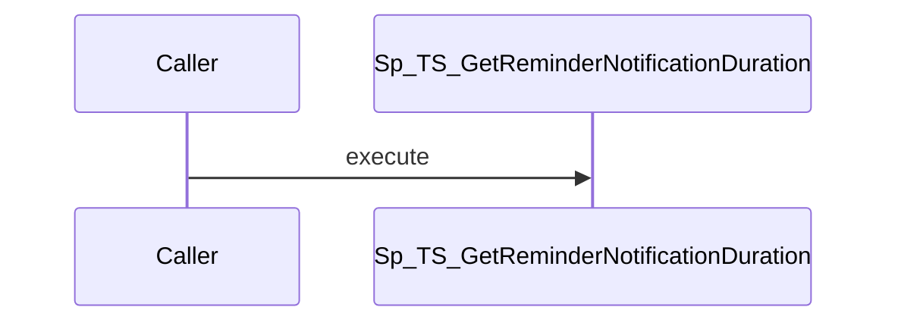
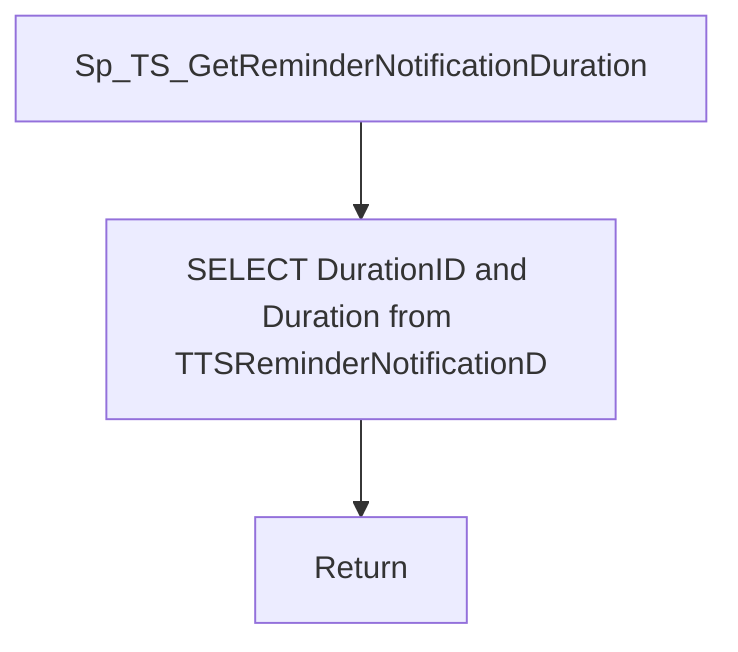

# Sp_TS_GetReminderNotificationDuration

## What it does

Returns active reminder notification duration options for the Configuration tab.

## Parameters

| Name | Direction | What it is for |
|---|---|---|
| _(none)_ | — | No parameters |

## Call sequence

## Callers

Application only. timeportDAL.GetDurationMasterData.

## Nested

This object does not execute another procedure or user-defined function.

## Steps

In `HRMS-DATABASE/HRM-TIMEPORT/STOREPROCEDURE/Sp_TS_GetReminderNotificationDuration.sql`:

1. SELECT DurationID and Duration from TTSReminderNotificationDuration where IsActive = 1.

## Tables

| Table | Read or write |
|---|---|
| `TTSReminderNotificationDuration` | read |

## Unresolved calls

None recorded for this page.

## Flow

