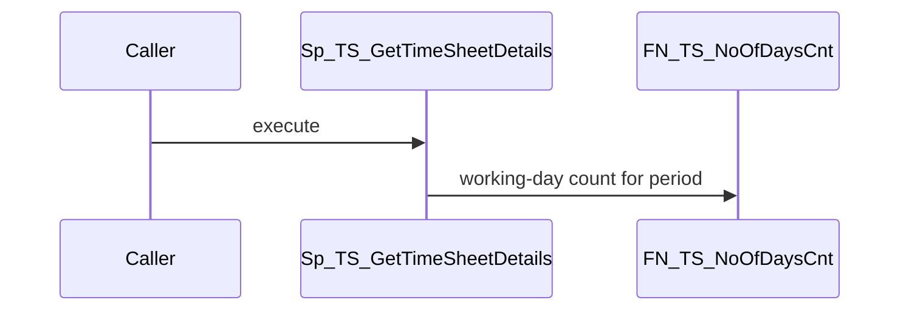
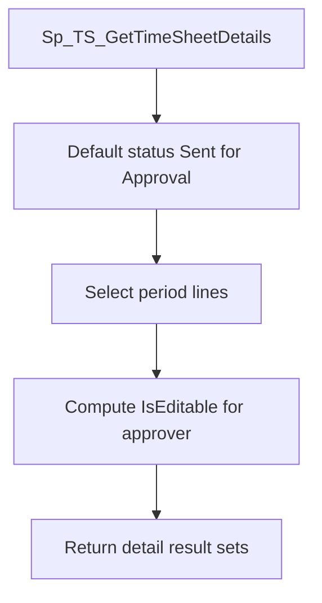

# Sp_TS_GetTimeSheetDetails

## What it does

Returns the day/line detail for one employee’s timesheet period on a project for the approval modal, including billable labels, editability for the logged-in approver, capacity/day helpers, and related metadata.

## Parameters

| Name | Direction | What it is for |
|---|---|---|
| `@pEmployerId` | in | Employer |
| `@pEmployeeId` | in | Timesheet owner |
| `@pProjectID` | in | Project (optional) |
| `@PFromDate` / `@PTodate` | in | Period |
| `@LoggedInUser` | in | Approver viewing the modal |
| `@pStatus` | in | Defaults to Sent for Approval status id when null |
| `@pReviewFreq` | in | Review frequency filter |

## Call sequence

## Callers

No other procedure or function under STOREPROCEDURE or FUNCTIONS executes this object. Application caller: TimePort DAL `GetTSApprovalDet`.

## Nested

| Object | Kind | When | Page |
|---|---|---|---|
| `FN_TS_NoOfDaysCnt` | function | working-day count | No page yet (TimePort synonym to HRMS) |

## Steps

In `HRMS-DATABASE/HRM-TIMEPORT/STOREPROCEDURE/Sp_TS_GetTimeSheetDetails.sql`:

1. Default `@pStatus` to Sent for Approval when null.
2. Select distinct timesheet lines with project/SDLC/work-item/location labels.
3. Mark `IsEditable` when logged-in user is the timesheet approver and status is Sent for Approval.
4. Use `FN_TS_NoOfDaysCnt` for working-day capacity context and return result sets used by the modal.

## Tables

| Table | Read or write |
|---|---|
| `TTSEmpTimeSheet` | read |
| `TSEmpTimesheetStatus` | read |
| `TTSLOOKUP` / lookup mapping tables | read |
| Project/client lookup sources via joins | read |

## Flow

