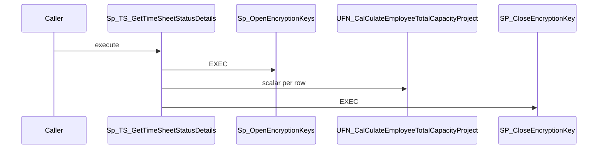
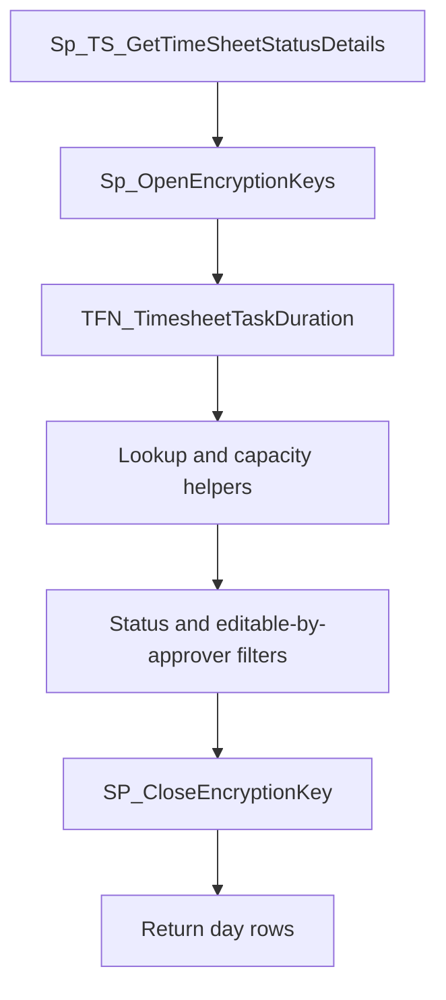

# Sp_TS_GetTimeSheetStatusDetails

## What it does

Returns day-level timesheet detail for one employee/project/date/status/approver context when the user expands a TimeSheet Status summary row. Uses `TFN_TimesheetTaskDuration` plus lookup/capacity helpers, then filters out certain editable-by-approver / sync edge cases before ordering by date.

## Parameters

| Name | Direction | What it is for |
|---|---|---|
| `@pEmployeeId` | in | Employee on the summary row |
| `@pEmployerId` | in | Employer context |
| `@pProjectID` | in | Project id (optional) |
| `@PFromDate` | in | Detail range start |
| `@PTodate` | in | Detail range end |
| `@pStatus` | in | Optional status filter |
| `@pTimeSheetApproverID` | in | Approver id from the summary row |

## Call sequence

## Callers

Application: TimePort `GetTimeSheetStatusDetails` (TimeSheet Status view-detail). No other procedure inventoried as a caller in this pass.

## Nested

| Object | Kind | When |
|---|---|---|
| `Sp_OpenEncryptionKeys` | procedure | Start |
| `TFN_TimesheetTaskDuration` | function | Base day rows |
| `TFN_LookupInfo` | function | Project name |
| `TFN_TsLookupInfo` | function | SDLC / work item / work product labels |
| `TFN_TsLookupInfoPlain` | function | Location name |
| `TFN_DateRangeByTSCycle` | function | Review-cycle date range (cross apply) |
| `UFN_CalCulateEmployeeTotalCapacityProject` | function | Total capacity and per-day capacity |
| `Fn_GetEmployeeName` | function | Employee and approver names |
| `SP_CloseEncryptionKey` | procedure | End |

## Steps

1. Open encryption keys.
2. Select from `TFN_TimesheetTaskDuration` joined to `TTSProjectConfiguration` with lookup outer applies.
3. Compute capacity via `UFN_CalCulateEmployeeTotalCapacityProject` for range and for each day.
4. Apply WHERE filters for status / `IsEditableByApprover` / `TimesSheetIsSync` combinations, correlating to `ttsemptimesheet` when needed.
5. Order by `TimeSheetDate` ascending; close encryption keys.

## Tables

| Table | Read or write |
|---|---|
| `TTSProjectConfiguration` | read |
| `ttsemptimesheet` / `TTSEmpTimeSheet` | read (exists checks in WHERE) |

Underlying TVFs also read timesheet and lookup tables.

## Unresolved calls

None for EXEC targets. Nested TVF bodies are not expanded beyond this level.

## Flow

