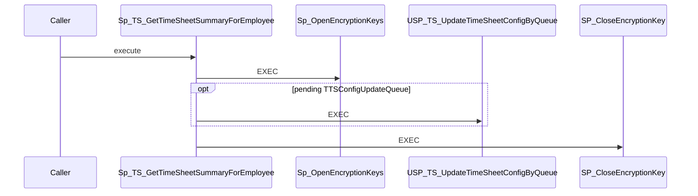
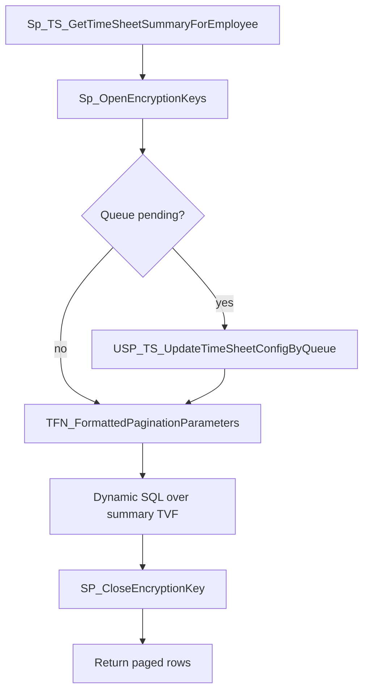

# Sp_TS_GetTimeSheetSummaryForEmployee

## What it does

Builds the TimeSheet Status summary grid: opens encryption keys, optionally flushes pending timesheet-config queue updates, then runs a dynamic SQL select over `TFN_TimesheetTaskDurationSummaryHistory_Status` filtered by employer/project/client org ids, status, business unit, and date range, with paging/sort from `TFN_FormattedPaginationParameters`.

## Parameters

| Name | Direction | What it is for |
|---|---|---|
| `@EmployeeId` | in | Employee whose timesheets are summarised |
| `@EmployerId` | in | Primary employer context (DAL still passes it; dynamic SQL uses `@EmployerIds`) |
| `@EmployerIds` | in | Comma-separated employer scope |
| `@ProjectId` | in | Optional project id list |
| `@PFromDate` | in | Range start |
| `@PTodate` | in | Range end |
| `@TsStatus` | in | Status id list; null expands to Open/Submitted/Sent for Approval/Approved/Rejected |
| `@BusinessUnit` | in | Optional BU filter passed into the TVF |
| `@ProjectOrgIds` | in | Optional `ProjectId+EmployerId` composite filter |
| `@ClientOrgIds` | in | Optional `ClientId+EmployerId` composite filter |
| `@PageNumber` | in | Page number for SSP |
| `@PageSize` | in | Page size |
| `@FilterJson` | in | Grid filter/sort JSON for `TFN_FormattedPaginationParameters` |

## Call sequence

## Callers

Application: TimePort `GetTimeSheetSummaryForEmployee` (TimeSheet Status search). No other procedure inventoried as a caller in this pass.

## Nested

| Object | Kind | When |
|---|---|---|
| `Sp_OpenEncryptionKeys` | procedure | Always at start |
| `USP_TS_UpdateTimeSheetConfigByQueue` | procedure | When `TTSConfigUpdateQueue` has `IsProcessed = 0` |
| `TFN_FormattedPaginationParameters` | function | Build filter/sort/offset strings |
| `TFN_TimesheetTaskDurationSummaryHistory_Status` | function | Core summary rows |
| `TFN_LookupInfo` | function | Project name via outer apply |
| `Fn_GetEmployeeName` | function | Employee and approver display names in dynamic SQL |
| `SP_CloseEncryptionKey` | procedure | Always at end |

## Steps

1. `EXEC Sp_OpenEncryptionKeys`.
2. If unprocessed rows exist in `TTSConfigUpdateQueue`, `EXEC USP_TS_UpdateTimeSheetConfigByQueue`.
3. Load default status ids from `TSEmpTimesheetStatus` when `@TsStatus` is null.
4. Derive filter/sort/offset via `TFN_FormattedPaginationParameters`.
5. Build and `sp_executesql` a select over the summary TVF joined to `TTSProjectConfiguration` and `TFN_LookupInfo`.
6. `EXEC SP_CloseEncryptionKey`.

## Tables

| Table | Read or write |
|---|---|
| `TTSConfigUpdateQueue` | read (existence check) |
| `TSEmpTimesheetStatus` | read |
| `TTSProjectConfiguration` | read |
| `TEmployeeInfo` | read (employment number subquery) |

TVFs also read timesheet/history tables internally (not expanded here).

## Unresolved calls

None for EXEC targets. TVF internals (`TFN_TimesheetTaskDurationSummaryHistory_Status`) are one level deeper and not expanded.

## Flow

