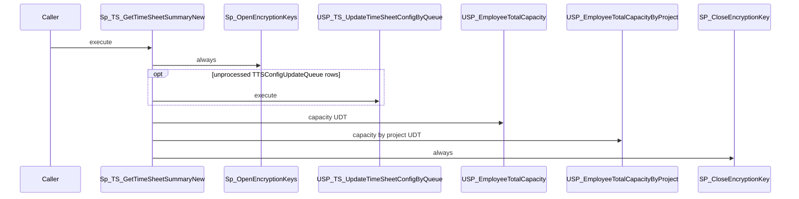
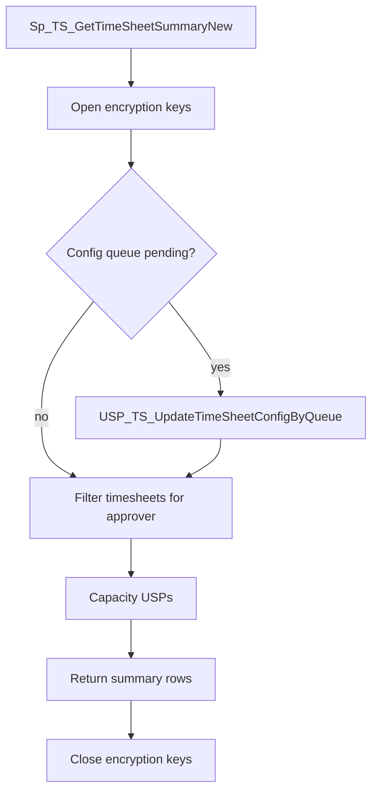

# Sp_TS_GetTimeSheetSummaryNew

## What it does

Builds the TimeSheet Approval summary grid for the logged-in approver: opens encryption keys, optionally drains `TTSConfigUpdateQueue`, filters `TTSEmpTimeSheet` by employer/project/status/date and approver mapping, computes capacity via nested USPs, and returns aggregated period rows (including comments and SubmittedOn).

## Parameters

| Name | Direction | What it is for |
|---|---|---|
| `@EmployerId` | in | Primary employer context |
| `@EmployerIds` | in | Comma-separated employer scope (optional) |
| `@EmployeeId` | in | Approver employee id (API passes JWT EID) |
| `@BusinessUnit` | in | Optional BU filter |
| `@ProjectId` | in | Optional project id list |
| `@PFromDate` / `@PTodate` | in | Date range |
| `@SDLC` / `@WorkProductType` | in | Optional lookup filters |
| `@TsStatus` | in | Status id list; defaults to Submitted/Sent for Approval/Approved/Rejected when null |
| `@ProjectOrgIds` / `@ClientOrgIds` | in | Multi-org project/client keys |
| `@PageNumber` / `@PageSize` | in | Pagination (API currently forces nulls) |
| `@FilterJson` | in | Grid filter JSON |

## Call sequence

## Callers

No other procedure or function under STOREPROCEDURE or FUNCTIONS executes this object. Application caller: TimePort DAL `GetTimeSheetSummary`.

## Nested

| Object | Kind | When | Page |
|---|---|---|---|
| `Sp_OpenEncryptionKeys` | procedure | start | [Sp_OpenEncryptionKeys](/docs/database/hrms/Sp_OpenEncryptionKeys) (HRMS; TimePort synonym) |
| `USP_TS_UpdateTimeSheetConfigByQueue` | procedure | when queue has `IsProcessed = 0` | [USP_TS_UpdateTimeSheetConfigByQueue](/docs/database/hrm-timeport/USP_TS_UpdateTimeSheetConfigByQueue) |
| `USP_EmployeeTotalCapacity` | procedure | after building capacity UDT | [USP_EmployeeTotalCapacity](/docs/database/hrm-timeport/USP_EmployeeTotalCapacity) |
| `USP_EmployeeTotalCapacityByProject` | procedure | after org capacity | [USP_EmployeeTotalCapacityByProject](/docs/database/hrm-timeport/USP_EmployeeTotalCapacityByProject) |
| `SP_CloseEncryptionKey` | procedure | end | [SP_CloseEncryptionKey](/docs/database/hrms/SP_CloseEncryptionKey) (HRMS; TimePort synonym) |

## Steps

In `HRMS-DATABASE/HRM-TIMEPORT/STOREPROCEDURE/Sp_TS_GetTimeSheetSummaryNew.sql`:

1. `SET NOCOUNT ON` and read-uncommitted isolation.
2. `EXEC Sp_OpenEncryptionKeys`.
3. If `TTSConfigUpdateQueue` has unprocessed rows, `EXEC USP_TS_UpdateTimeSheetConfigByQueue`.
4. Default `@TsStatus` to Submitted / Sent for Approval / Approved / Rejected when null.
5. Build filtered timesheet working set for the approver and related project/client/org filters.
6. Populate `@UDT_EmployeeTotalCapacity` and execute `USP_EmployeeTotalCapacity` then `USP_EmployeeTotalCapacityByProject`.
7. Return aggregated summary rows joined to employee/project/client metadata.
8. `EXEC SP_CloseEncryptionKey`.

## Tables

| Table | Read or write |
|---|---|
| `TTSConfigUpdateQueue` | read |
| `TSEmpTimesheetStatus` | read |
| `TTSEmpTimeSheet` | read |
| `TTSProjectConfiguration` | read |
| `TEmployeeInfo` | read |
| `TProject` | read |
| `TClient` | read |

## Flow

