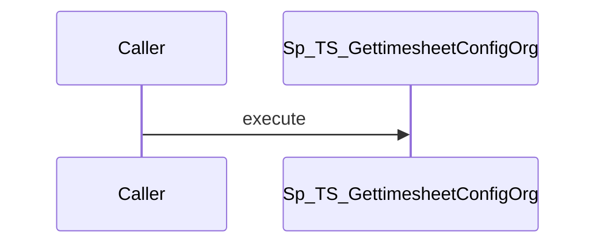
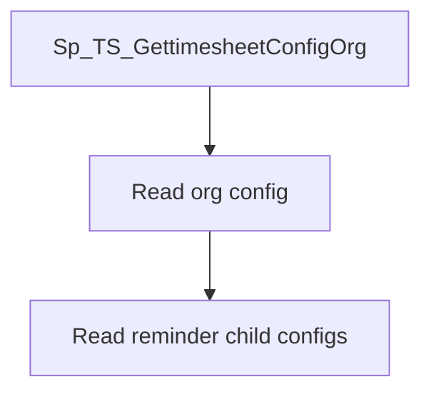

# Sp_TS_GettimesheetConfigOrg

## What it does

Returns organization-level timesheet UI/config flags (time format, auto duration/dropdown, reminder settings, auto-save) plus related reminder BU/designation/employee config result sets for one employer.

## Parameters

| Name | Direction | What it is for |
|---|---|---|
| `@pEmployerId` | in | Employer |

## Call sequence

## Callers

No other procedure or function under STOREPROCEDURE or FUNCTIONS executes this object. Application caller: TimePort DAL `GetTimesheetConfigOrg`.

## Nested

Calls no other procedures or functions.

## Steps

In `HRMS-DATABASE/HRM-TIMEPORT/STOREPROCEDURE/Sp_TS_GettimesheetConfigOrg.sql`:

1. Select from `TtimesheetConfigOrg` for the employer.
2. Select reminder BU, designation, and employee config tables for the same employer.

## Tables

| Table | Read or write |
|---|---|
| `TtimesheetConfigOrg` | read |
| `TtimesheetReminderBusinessUnitConfig` | read |
| `TtimesheetReminderDesignationConfig` | read |
| `TtimesheetReminderEmployeeConfig` | read |

## Flow

