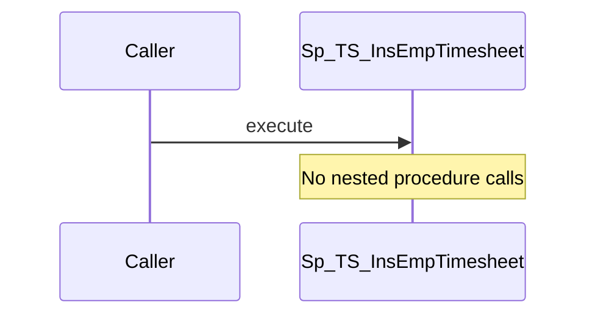
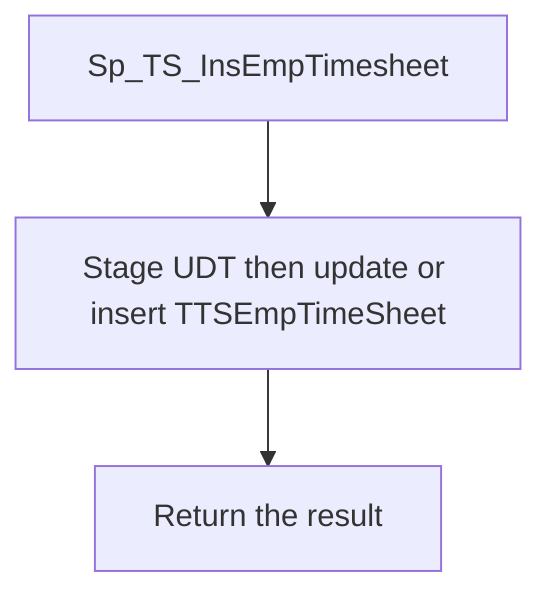

# Sp_TS_InsEmpTimesheet

## What it does

Persists Daily/Weekly/mobile timesheet rows from the `t_EmpTimesheet` UDT: matches existing rows by date/task, updates or inserts into `TTSEmpTimeSheet`, and sets SubmittedOn when status is submitted.

## Parameters

| Name | Direction | What it is for |
|---|---|---|
| `@WeekStartdate` | in | Week/range start |
| `@WeekEndDate` | in | Week/range end |
| `@TimesheetDetails` | in | UDT `t_EmpTimesheet` rowset |

## Call sequence

## Callers

Application caller: TimePort API `InsEmpTimesheet` for TimePort → TimeSheet save/submit/withdraw.

## Nested

| Object | Kind | When | Page |
|---|---|---|---|
| _(none)_ | — | — | — |

## Steps

In `HRMS-DATABASE/HRM-TIMEPORT/STOREPROCEDURE/Sp_TS_InsEmpTimesheet.sql`:

1. Copy UDT into `#lTimesheetDetails` with week number helper.
2. Resolve TimesheetId for existing tasks; UPDATE matching rows.
3. INSERT new rows into `TTSEmpTimeSheet`.
4. Handle soft-deletes / Action_Flag paths for withdrawn or removed tasks.

## Tables

| Table | Read or write |
|---|---|
| `TTSEmpTimeSheet` | read/write |

## Unresolved calls

None identified beyond the nested objects listed above.

## Flow

