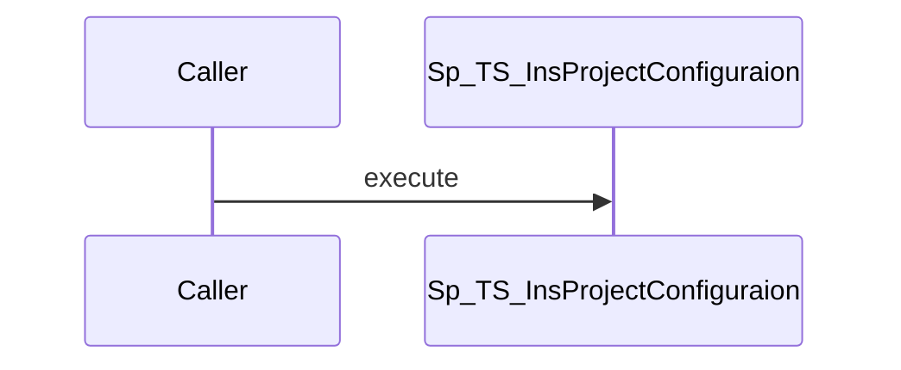
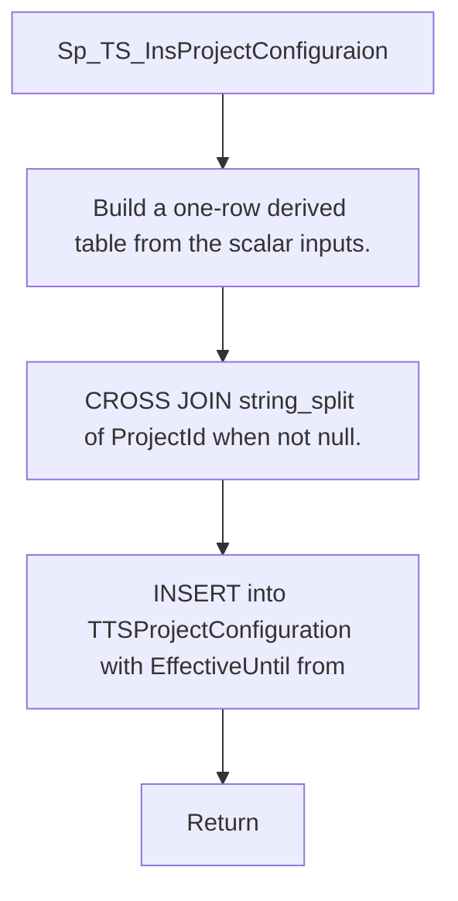

# Sp_TS_InsProjectConfiguraion

## What it does

Inserts one or more TimePort project configuration rows into TTSProjectConfiguration for the employer, splitting ProjectId on commas.

## Parameters

| Name | Direction | What it is for |
|---|---|---|
| `@ProjectId` | in | Comma-separated project ids |
| `@Projectname` | in | Project display name accepted by DAL |
| `@ProjectDesc` | in | Project description |
| `@BusinessId` | in | Line of business lookup id |
| `@CostCenter` | in | Cost center lookup id |
| `@Frequency` | in | Review frequency code |
| `@ShowAttendanceData` | in | Show attendance flag |
| `@TaskStartEndTimeReq` | in | Task start/end time required flag |
| `@StartDate` | in | Config start date |
| `@EndDate` | in | Config end date |
| `@ReminderFrequency` | in | Reminder frequency code |
| `@SDLCReq` | in | SDLC required flag |
| `@WorkProductTypeReq` | in | Work product type required flag |
| `@IsActive` | in | Active flag (insert forces Y on new rows) |
| `@EmployerId` | in | Employer id |
| `@CreatedBy` | in | Creating employee id |
| `@ClientId` | in | Client id |
| `@IsDescriptionMandatory` | in | Description mandatory flag |
| `@TimesSheetIsSync` | in | Timesheet sync flag |
| `@EffectiveDate` | in | Stored as EffectiveUntil |
| `@InvoicingFreq` | in | Invoicing frequency |
| `@IsHolidaysIncludedForTSExport` | in | Holiday export flag |
| `@IsLeavesIncludedForTSExport` | in | Leave export flag |

## Call sequence

## Callers

Application only. timeportDAL.InsertProjectConfiguration from TimePort Setup Master Projects tab.

## Nested

This object does not execute another procedure or user-defined function.

## Steps

In `HRMS-DATABASE/HRM-TIMEPORT/STOREPROCEDURE/Sp_TS_InsProjectConfiguraion.sql`:

1. Build a one-row derived table from the scalar inputs.
2. CROSS JOIN string_split of ProjectId when not null.
3. INSERT into TTSProjectConfiguration with EffectiveUntil from EffectiveDate.

## Tables

| Table | Read or write |
|---|---|
| `TTSProjectConfiguration` | write |

## Unresolved calls

None recorded for this page.

## Flow

