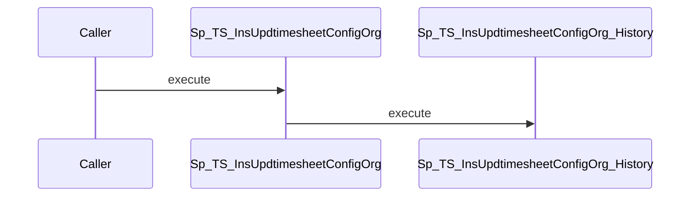
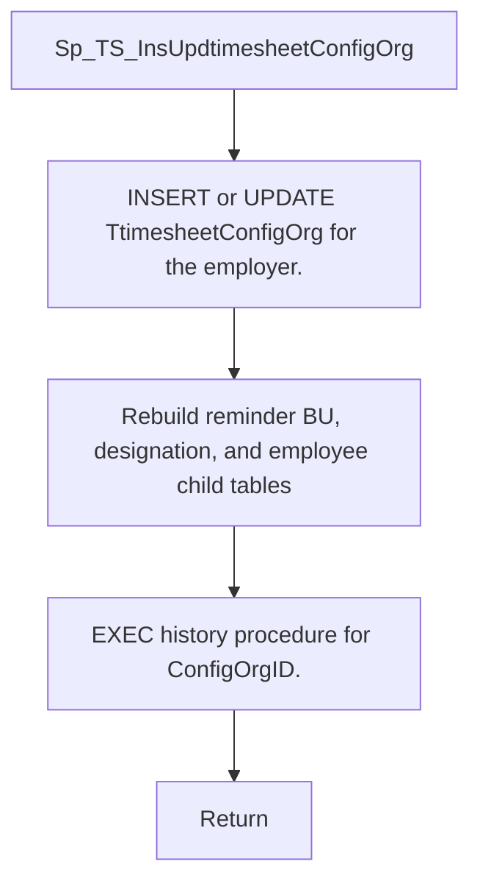

# Sp_TS_InsUpdtimesheetConfigOrg

## What it does

Inserts or updates organisation timesheet autofill, reminder, and auto-save configuration, refreshes reminder scope child tables, and writes history via nested Sp_TS_InsUpdtimesheetConfigOrg_History.

## Parameters

| Name | Direction | What it is for |
|---|---|---|
| `@pEmployerId` | in | Employer id |
| `@pIsDurationAuto` | in | Autofill duration flag |
| `@pIsDropdownAuto` | in | Autofill dropdown flag |
| `@pTimeFormatInHoursMins` | in | Time format flag |
| `@IsReminderEnabled` | in | Reminder enabled |
| `@ReminderNotificationStartDate` | in | Reminder start day code |
| `@DurationID` | in | Reminder duration id |
| `@IsHolidayReminder` | in | Holiday reminder flag |
| `@IsTimeOffReminder` | in | Time-off reminder flag |
| `@BusinessUnitIDs` | in | Comma-separated BU ids |
| `@DesignationIDs` | in | Comma-separated designation ids |
| `@EmployeeIDs` | in | Comma-separated employee ids |
| `@AutoSaveBehaviour` | in | Auto-save behaviour code |
| `@CreatedBy` | in | Acting employee id |

## Call sequence

## Callers

Application only. timeportDAL.SetTaskAutoFillConfig.

## Nested

| Object | Kind | Page |
|---|---|---|
| `Sp_TS_InsUpdtimesheetConfigOrg_History` | procedure | [Sp_TS_InsUpdtimesheetConfigOrg_History](/docs/database/hrm-timeport/Sp_TS_InsUpdtimesheetConfigOrg_History) |

## Steps

In `HRMS-DATABASE/HRM-TIMEPORT/STOREPROCEDURE/Sp_TS_InsUpdtimesheetConfigOrg.sql`:

1. INSERT or UPDATE TtimesheetConfigOrg for the employer.
2. Rebuild reminder BU, designation, and employee child tables from STRING_SPLIT lists.
3. EXEC history procedure for ConfigOrgID.

## Tables

| Table | Read or write |
|---|---|
| `TtimesheetConfigOrg` | write |
| `TtimesheetReminderEmployeeConfig` | write |

## Unresolved calls

None recorded for this page.

## Flow

