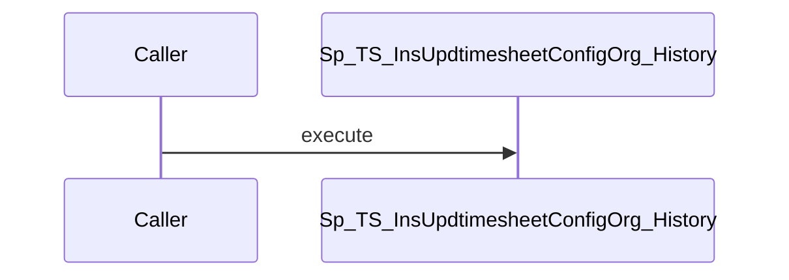
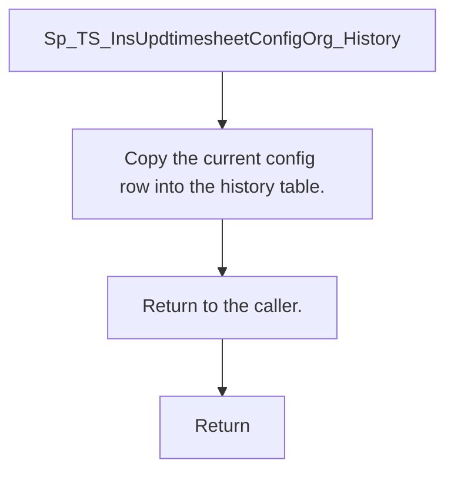

# Sp_TS_InsUpdtimesheetConfigOrg_History

## What it does

Writes a history snapshot for an organisation timesheet configuration change.

## Parameters

| Name | Direction | What it is for |
|---|---|---|
| `@ConfigOrgID` | in | Config org id |
| `@CreatedBy` | in | Acting employee id |

## Call sequence

## Callers

Sp_TS_InsUpdtimesheetConfigOrg.

## Nested

This object does not execute another procedure or user-defined function.

## Steps

In `HRMS-DATABASE/HRM-TIMEPORT/STOREPROCEDURE/Sp_TS_InsUpdtimesheetConfigOrg_History.sql`:

1. Copy the current config row into the history table.
2. Return to the caller.

## Tables

| Table | Read or write |
|---|---|
| `TtimesheetConfigOrg` | read |

## Unresolved calls

None recorded for this page.

## Flow

